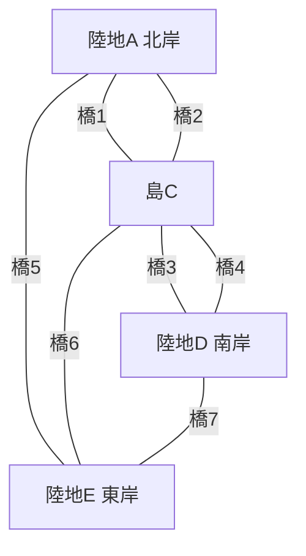
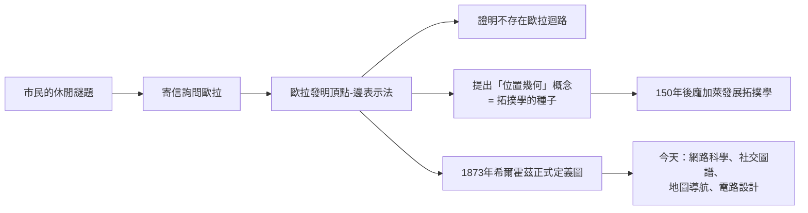

# 2.3 1736年 柯尼斯堡七橋問題

## 事件

1736 年，歐拉發表《關於位置幾何問題的解法》（Solutio problematis ad geometriam situs pertinentis），解決了著名的**柯尼斯堡七橋問題**，這篇論文被公認為**圖論與拓撲學的起點**。

## 問題

普魯士柯尼斯堡（今加里寧格勒）由普列戈利亞河分成四塊陸地，由七座橋連接。市民想知道：能否**每座橋恰好走一次**而回到起點？

## 歐拉的洞見：抽掉幾何，只留連接

歐拉的關鍵一步是：**陸地的大小、形狀、橋的長度全部無關緊要，重要的是「哪兩塊陸地之間有幾座橋」**。用現代語言，他發明了「頂點 + 邊」的表示法：

$$
\deg(v) = \text{與頂點 } v \text{ 相連的橋數}
$$

**結論**：一筆畫迴路存在 ⟺ 所有頂點的度數都是偶數。而七橋問題的四塊陸地度數為 $3, 3, 3, 5$ （全為奇數），故不可能。

## 前因後果

## 意義

這是數學史上第一次「把問題的幾何外殼剝掉、只研究結構」的成功示範。歐拉本人當時未必意識到，他開創的不只是一個問題的解法，而是一整個新數學分支。
