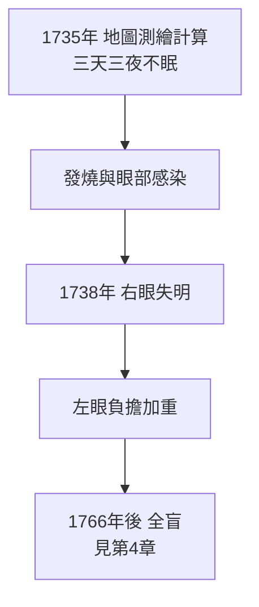

# 2.4 1738年 右眼失明與離開的決定

## 事件

1738 年，歐拉**右眼幾乎完全失明**。同時期，聖彼得堡的政治氛圍日益嚴酷，他開始為離開做準備。

## 前因：失明的原因

- 1735 年，歐拉為科學院執行一項**地圖測繪的天文計算**任務，連續高強度工作三天後發燒，右眼感染發炎。
- 後來膿腫惡化，1738 年右眼視力喪失。
- 數學史家推測可能也與長期用眼過度有關（但青光眼假說也有爭議）。

## 前因：政治環境的惡化

1730-1740 年安娜女皇統治時期，俄羅斯陷入「比倫時代」（Bironovshchina）的恐怖統治：

- 言論與思想控制加劇，科學院被保守派把持。
- 1740 年安娜去世後，宮廷政變頻繁，科學院經費再度被砍。
- 歐拉作為外國學者，處境日漸尷尬。

## 後果：柏林的機會窗口

就在此時，普魯士新王**腓特烈二世（腓特烈大帝）**於 1740 年即位。腓特烈想重建柏林科學院，第一個物色的對象就是歐洲最有名的數學家。1741 年，歐拉接受邀請離開聖彼得堡（見 3.1）。

> 失明沒有阻止歐拉，但政局的惡化給了柏林一個千載難逢的機會——**個人厄運與政治變動的交錯，成就了一段 25 年的柏林時期。**
