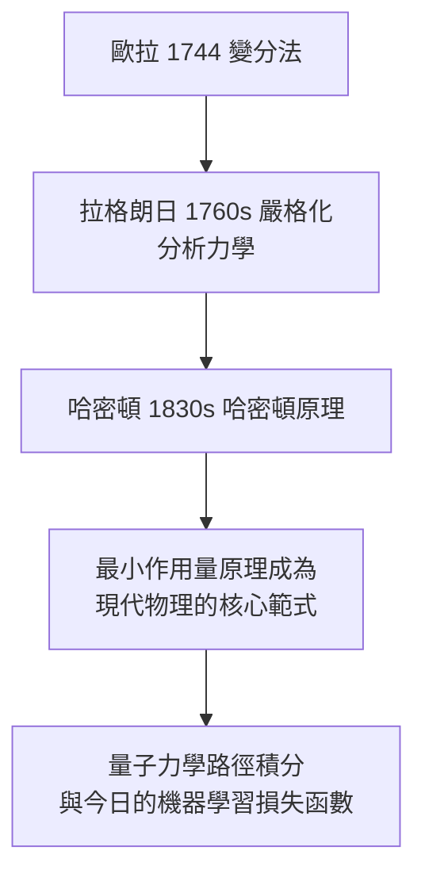

# 3.2 1744年 變分法與《無窮分析引論》

## 事件

1744 年，歐拉出版《尋求具有某種極大或極小性質的曲線的技巧》（Methodus inveniendi），**創立變分法**；1748 年出版《無窮分析引論》（Introductio in analysin infinitorum），奠定現代分析的語言。

## 前因：最速降線問題（1696）

1696 年約翰·伯努利提出「最速降線」挑戰：質點在重力下沿哪條曲線下滑最快？答案：擺線。牛頓、萊布尼茨、伯努利兄弟都解了。這類問題的共同結構是：

$$
\min_{y(x)} \; J[y] = \int_{a}^{b} F(x, y, y')\, dx
$$

也就是**要優化的對象是一個積分（函數的函數）**，而不是普通函數的極值。

## 歐拉的做法：從離散到連續

歐拉把曲線切成 $n$ 段折線，對有限個折點用普通微積分求極值，再令 $n \to \infty$ 。他得到**歐拉-拉格朗日方程**的早期形式：

$$
\frac{\partial F}{\partial y} - \frac{d}{dx}\frac{\partial F}{\partial y'} = 0
$$

## 後果：物理學被重寫

變分法讓「大自然取極值」從哲學直覺變成可計算的數學原理。今天優化神經網路的梯度下降，本質上仍在這條譜系上。

## 《無窮分析引論》：分析的《幾何原本》

1748 年的《引論》做了兩件劃時代的事：

1. **把函數放到分析的中心**（此前數學以曲線為對象）。
2. 系統化指數、對數、三角函數與級數，包括著名的歐拉公式（見 3.3）。

歐拉在書中寫道：分析學是「無窮量的代數」。這本書此後百年是全歐洲的標準教材，高斯、柯西、阿貝爾都讀它長大。
