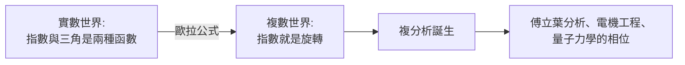

# 3.3 1748年 $e^{i\pi}$ 與公式革命

## 事件

在 1748 年《無窮分析引論》中，歐拉發表了**歐拉公式**：

$$
e^{ix} = \cos x + i\sin x
$$

取 $x = \pi$ ，即得**歐拉恆等式**：

$$
e^{i\pi} + 1 = 0
$$

## 前因：三個常數的三段歷史

| 常數 | 誰先遇到它 | 歐拉做了什麼 |
|------|-----------|-------------|
| $e$ | 1683 伯努利研究複利 $\lim(1+1/n)^n$ | 1727-1736 命名為 $e$ ，建立 $e^x$ 理論 |
| $\pi$ | 古代 | 1736 推廣記號並嚴格化其用法 |
| $i$ | 1545 卡爾達諾的「詭異量」 | 1777 引入記號 $i$ |

## 為什麼這是革命？

歐拉的推導（用現代語言）：把 $e^x$ 、 $\cos x$ 、 $\sin x$ 都展開成級數：

$$
e^{ix} = 1 + ix + \frac{(ix)^2}{2!} + \frac{(ix)^3}{3!} + \cdots
$$

按實部虛部整理，實部恰好是 $\cos x$ 的級數、虛部恰好是 $\sin x$ 。於是指數函數與三角函數**是同一件事**：

- **指數 = 旋轉**： $e^{i\theta}$ 代表複平面上轉 $\theta$ 角。這把「週期現象」與「增長現象」統一起來。
- 傅立葉變換（1807）、麥克斯韋方程的複數形式、量子力學波函數 $e^{i\omega t}$ ——全部立在這個公式上。

## 費馬大定理的遠親： $\zeta$ 函數的起點

歐拉 1737 年定義（後稱黎曼 $\zeta$ 函數）：

$$
\zeta(s) = \sum_{n=1}^{\infty} \frac{1}{n^s} = \prod_{p \text{ prime}} \frac{1}{1-p^{-s}}
$$

這個**級數-質數乘積等式**是 122 年後黎曼假說的直接起點。
