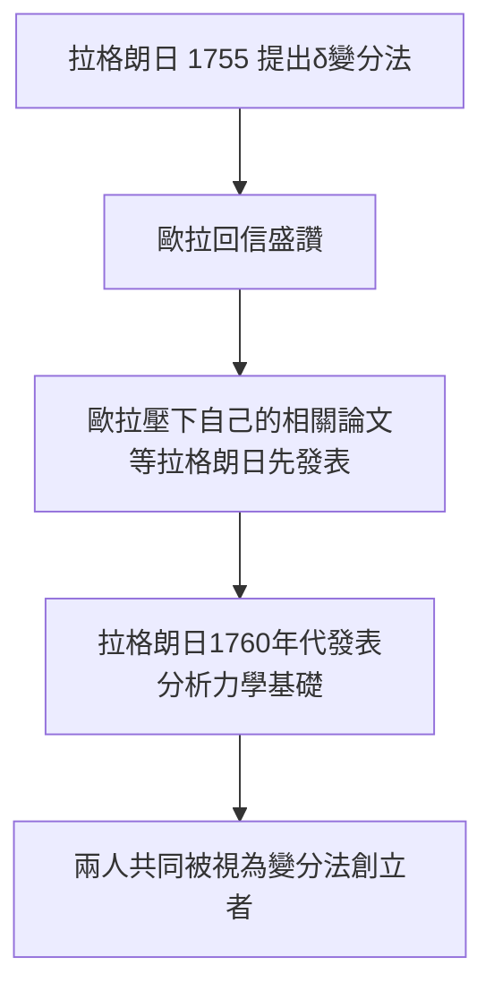

# 3.4 1759年 拉格朗日與變分法的交棒

## 事件

1755-1759 年間，歐拉與年僅 19 歲的**約瑟夫-路易·拉格朗日**（Joseph-Louis Lagrange）開始通信。拉格朗日給出了變分法的更優雅解法，歐拉不但公開讚揚，還**刻意壓下自己的新論文**，等拉格朗日先發表。

## 前因

- 1754 年，都靈的少年拉格朗日讀到歐拉 1744 年的變分法著作，發現可以用「變分 $\delta$ 」的符號把歐拉的折線法改寫得純分析化。
- 1755 年 8 月 12 日拉格朗日寫信給歐拉。歐拉回信：新方法「立刻把你帶到目標，如果我的方法需要繞路」。

## 歐拉的大度：學術史上的美談

歐拉在 1764 年發表相關成果時，公開說明拉格朗日的方法優於自己的。這種把後輩推上舞台的胸襟，在優先權爭奪頻發的 18 世紀極為罕見（對照：牛頓與萊布尼茨的微積分之爭）。

## 後果

- 拉格朗日 1766 年接替歐拉出任柏林科學院數學部主任——**腓特烈的下一個獵物**。腓特烈寫信給他：「歐洲最偉大的國王需要歐洲最偉大的數學家。」
- 拉格朗日 1788 年的《分析力學》把整個力學公理化，是歐拉-拉格朗日譜系的頂點。
- 兩人通信 25 年（1754-1783 歐拉去世前），是 18 世紀數學傳承的主軸之一。
