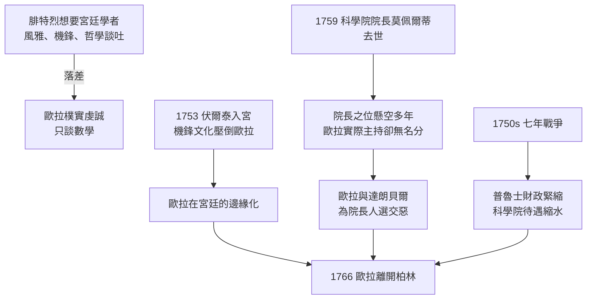

# 3.5 1766年 與腓特烈失和

## 事件

1766 年，59 歲的歐拉離開服務 25 年的柏林科學院，接受葉卡捷琳娜二世的邀請重返聖彼得堡。

## 前因：裂痕如何累積

## 最後一根稻草

腓特烈遲遲不任命新院長，卻讓達朗貝爾（歐拉的論敵）在 1763-1765 年間兩度來柏林諮詢。達朗貝爾向國王建議的並非歐拉。歐拉感到受辱，而此時——

- 葉卡捷琳娜二世（1762 年政變上台）正大力招募西方學者重建俄羅斯榮光；
- 開出的條件甚至優於柏林：雙倍薪俸、宅邸、並承諾其子任科學院職。

## 後果

- 柏林方面:腓特烈用拉格朗日補位（見 3.4），柏林科學院繼續繁榮，但失去的不只是數學家——還有歐拉多年建立的出版與組織制度。
- 俄羅斯方面:葉卡捷琳娜以「國賓」規格迎接（宫廷为她支付搬家费高达8000卢布，包括歐拉的廚師與私人樂器）。
- 個人層面:歐拉重返聖彼得堡後不久左眼也將失明——但正因回到視他如國寶的俄羅斯，失明的歐拉反而獲得最好的研究支援（見第 4 章）。
