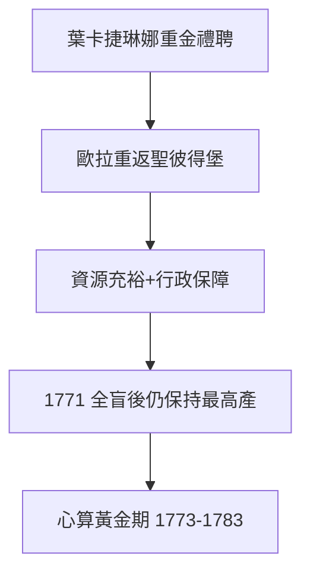

# 4.1 1766年 葉卡捷琳娜二世的召喚

## 事件

1766 年 7 月，歐拉重返聖彼得堡，受葉卡捷琳娜二世（Catherine the Great）禮遇，被譽為「數學的沙皇」。

## 前因：葉卡捷琳娜的西化戰略

葉卡捷琳娜 1762 年政變奪位後，以「開明專制」形象統治：

- 她本人與伏爾泰、狄德羅通信，購買狄德羅的藏書圖書館並聘他為館長（有薪水、住在聖彼得堡）。
- 重建科學院是她的文明工程核心：**請回歐拉**是最響亮的一招。

## 條件的對比

| 項目 | 柏林（1766前） | 聖彼得堡（1766） |
|------|---------------|-----------------|
| 薪俸 | 受七年戰爭拖累、縮水 | 3000 盧布，接近柏林兩倍 |
| 待遇 | 院長之位懸空、受辱 | 宅邸、宮廷座次僅次於皇室 |
| 尊重 | 國王公開貶抑數學部 | 「數學的沙皇」 |

## 後果：最後 17 年的最高產

歐拉回聖彼得堡後，產量不但沒有下降，反而達到巔峰：1766-1783 年間發表約 **400 篇**論文（占其一生的一半），其中大部分是在**全盲**之後完成的（見 4.2、4.3）。

## 一個關鍵的制度設計

葉卡捷琳娜的宮廷尊重歐拉到什麼程度？有則著名軼事：法國哲學家狄德羅來訪時在宮廷宣揚無神論，葉卡捷琳娜請歐拉出場。歐拉走到狄德羅面前說：

> 「先生，$\frac{a+b^n}{n} = x$，所以上帝存在，請回答！」

狄德羅不懂代數，啞口無言，尷尬離開。（此軼事出自狄德羅傳記，真實性存疑，但完美體現宮廷對歐拉的信任與歐拉的信仰。）
