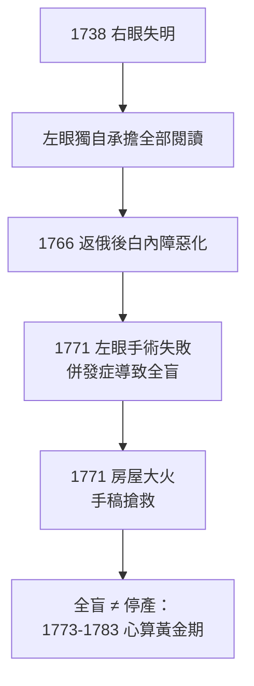

# 4.2 1771年 全盲

## 事件

1771 年，歐拉的**左眼也失明**，從此全盲。同年他的房子毀於大火，他與家人在僕人的背負下逃生，手稿幸而搶救出來。

## 前因後果鏈

## 意外中的意外：手稿之幸

1771 年 5 月的大火燒毀了住宅。歐拉的眼睛看不見，幾乎無法自救；是一位來自巴塞爾的僕人格里姆（Peter Grimmler）衝進火場把他背出來。更關鍵的是大部分手稿被搶救——其中包括《代數指南》（Vollständige Anleitung zur Algebra，1770）的草稿，此書後來成為影響百年的代數教科書。

## 全盲的歐拉如何工作？

歐拉建立了一支**「人肉計算機」團隊**：

- 他口述，兒子約翰·阿爾布雷希特（Johann Albrecht）與一群秘書、學生執筆。
- 他擁有近乎完美的記憶力：能記住整頁整頁的公式與文獻內容。
- 他能在腦中完成複雜的代數運算與級數展開。

> 法國學者孔多塞（Condorcet）在悼詞中寫道：「他全盲之後，反而少了書寫的干擾，心算的疆域更遼闊了。」

## 後果

失明帶來的「外部輸入減少」迫使歐拉把全部注意力放在抽象結構上。1770s 他完成：

- 月球運動理論的完整分析（解決航海經度的三體問題近似）
- 《代數指南》（1770）
- 曲面論、二項式定理的嚴格化、數論的諸多貢獻

這段歷史成為數學史上最動人的篇章之一：**黑暗中，數學反而更明亮。**
