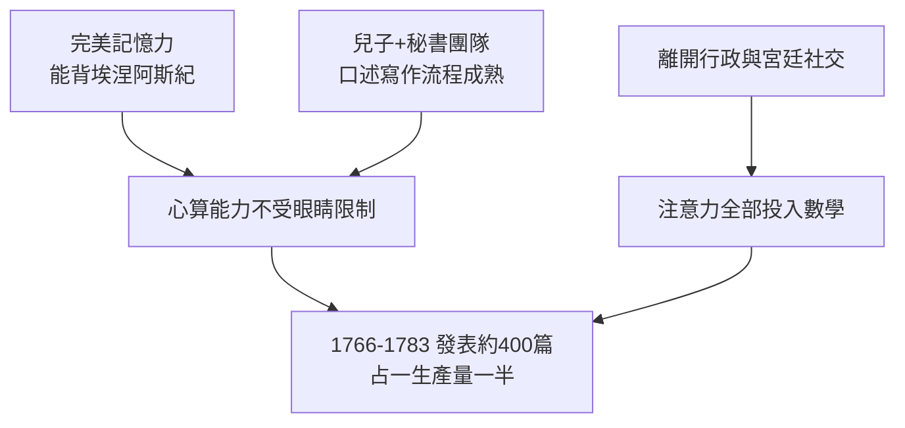

# 4.3 1773年 心算黃金期

## 事件

1773 年妻子卡特琳娜去世後，歐拉在兒子與學生的協助下進入**心算黃金期**：全盲狀態下完成了他一生中幾項最深刻的成果。

## 全盲後的主要成果

| 年份 | 成果 | 意義 |
|------|------|------|
| 1770 | 《代數指南》 | 影響百年；高斯自述由此入門 |
| 1772 | 發現梅森質數 $2^{31}-1$ | 以心算驗證一個 10 位數的質性，保持最大質數紀錄近百年 |
| 1773-1775 | 月球運動理論 | 三體問題的解析近似，成為航海定位的實用工具 |
| 1776-1780 | 曲面論、測地線 | 為微分幾何鋪路 |
| 1782 | 拉丁方與正交拉丁方 | 36 軍官問題的起源，組合設計的先聲 |

## 前因：為何全盲後反而高產？

## 月球運動理論：實用數學的巔峰

18 世紀最大的工程問題之一是**航海經度測定**：在海上不知經度就不知船位，觸礁頻繁。月亮相對星體的運動可以做「天上的時鐘」，但三體問題沒有解析解。

歐拉在 1770s 用微擾法給出足夠精確的月球位置表，英國航海年鑑直接採用。這是「純數學救人性命」的經典案例——而全部計算由一位盲人以心算完成。

## 數論：費馬問題的接力

歐拉晚年繼續攻克費馬留下的命題：

- 證明 $n=3$ 時 $x^3+y^3=z^3$ 無正整數解（費馬大定理的第一個實質進展）。
- 提出**歐拉猜想**（後來被證偽，但催生了 1988 年的 Elkiies 反例研究）。
- 發明**歐拉函數** $\varphi(n)$ 與歐拉定理 $a^{\varphi(n)} \equiv 1 \pmod n$ ——這正是今日 **RSA 加密**的數學心臟。
