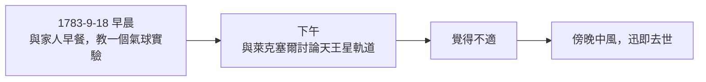
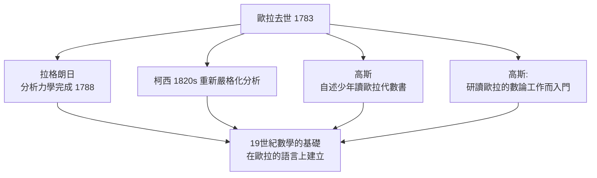

# 4.4 1783年 逝世與「他停止了計算」

## 事件

1783 年 9 月 18 日，歐拉在聖彼得堡家中去世，享壽 76 歲。據記載，當天下午他還在與萊克塞爾（Lexell）討論新發現的天王星軌道計算，之後中風倒下。

> 孔多塞的悼詞留下了那句名言：**「他停止了計算與生命。」**（Il cessa de calculer et de vivre.）

## 前因：最後一天的日程

天王星 1781 年才由赫歇爾發現——歐拉人生最後的科學活動，是把最新的觀測數據納入他畢生推動的軌道力學。**他的數學工作停在了科學的最前線。**

## 身後：產量的總帳

- 論文與著作合計 **850+ 種**（含 8000+ 封通信）。
- 聖彼得堡科學院從 1783 年起，**繼續整理出版他的遺稿長達 47 年**（至 1830 年）。
- 1911 年起瑞士開始出版《歐拉全集》（Opera Omnia），至今已逾 80 卷。

## 後果：一代人的老師

拉普拉斯的話最能概括：**「讀讀歐拉，讀讀歐拉，他是我們所有人的老師。」**（Lisez Euler, lisez Euler, c'est notre maître à tous.）
