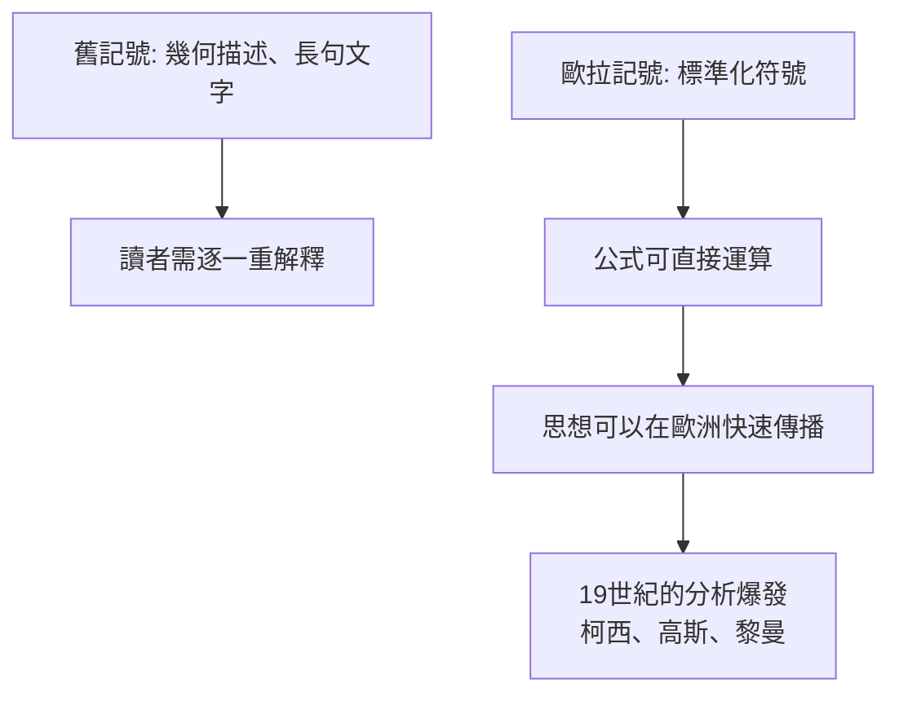

# 5.1 記號革命： $e$ 、 $i$ 、 $\pi$ 與 $f(x)$

## 事件

歐拉確立了今日全世界學生書寫數學的符號系統。這不是「順手起名」，而是一場**讓思想可以無摩擦傳播的革命**。

## 歐拉的記號遺產一覽

| 記號 | 引入年份 | 含義 |
|------|---------|------|
| $f(x)$ | 1734 | 函數記號，宣告「函數是分析的對象」 |
| $e$ | 1727-1736 | 自然指數的底 |
| $\pi$ | 1736-1748 | 推廣並確立（威廉·瓊斯 1706 首用） |
| $i$ | 1777 | 虛數單位 |
| $\Sigma$ | 1755 | 求和記號 |
| $\sin, \cos, \tan$ | 1748 | 三角函數縮寫系統化 |
| $\Delta, \delta$ | 1755 | 差分與變分（ $\delta$ 後為拉格朗日採用） |

## 為什麼記號這麼重要？

對比：牛頓的「流數術」記號 $\dot{x}$ 在英國用了 150 年，阻礙了英國數學與歐陸的交流。歐拉的記號則成為**全人類的共同語言**——這可能是他對現代科學最無形也最深遠的貢獻。

## 函數概念的哲學轉變

歐拉把 $f(x)$ 放到舞台中央，代表一個觀念轉變：

- **之前**：數學研究「曲線」（幾何對象）。
- **之後**：數學研究「函數」（代數-分析對象），曲線只是函數的圖像。

現代電腦科學中 `f(x) = ...`、函數式編程、甚至 API 的概念譜系，都始於這次轉向。
