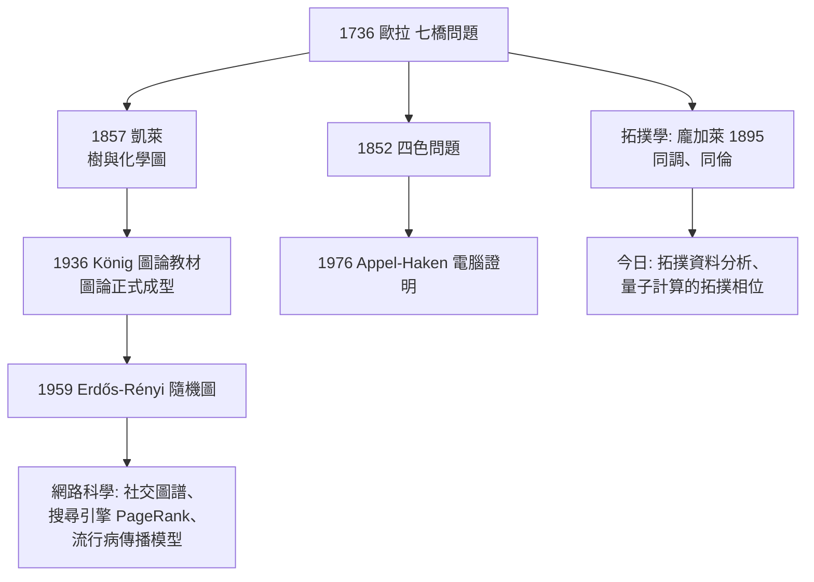

# 5.2 圖論與拓撲的起源

## 事件

1736 年的七橋問題論文（見 2.3）是圖論與拓撲學共同的起點。歐拉稱這類研究為「位置幾何」（geometria situs）——**只與連接方式有關、與度量無關的幾何**。

## 歐拉的原始貢獻

1. **頂點-邊表示法**：抽象掉幾何細節（今日 `networkx`、地圖導航、社群圖譜的基本語言）。
2. **度數分析**：$\sum \deg(v) = 2|E|$（今日稱為「握手引理」）。
3. **存在性判準**：一筆畫迴路 ⟺ 連通且無奇度頂點。

## 譜系：從七橋到現代科技

## 拓撲的另一條線：歐拉示性數

歐拉 1750 年發現多面體公式：

$$
V - E + F = 2
$$

（頂點數 − 邊數 + 面數 = 2）。這個「不隨形狀改變、只隨洞數改變」的不變量，就是**拓撲不變量**的第一個例子。1858 年莫比烏斯與利斯廷正式建立拓撲學，龐加萊 1895 年系統化——歐拉公式是他們的共同起點。

## 從「娛樂謎題」到「科學」

七橋問題給數學史留下方法論教訓：**有時偉大的科學始於一個被認為不值得研究的休閒難題**。歐拉本人的態度是：「這問題雖看似平凡，但它的解法似乎不屬於已知的數學範圍。」——對「看似平凡」的問題保持敬畏，正是他的偉大之處。
