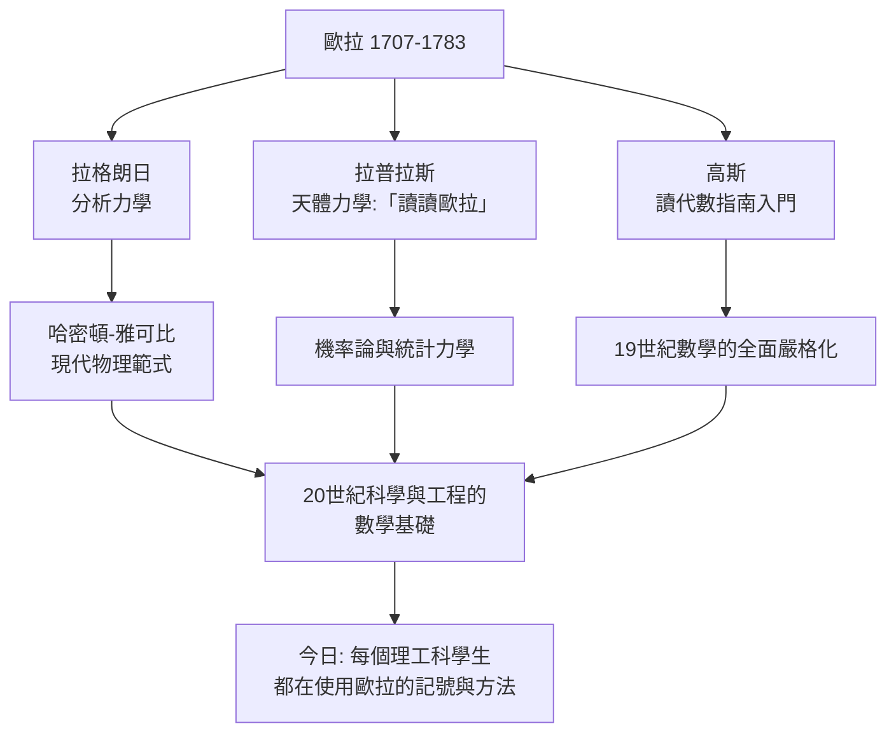

# 6.2 身後影響：從圖論到機器學習

## 歐拉概念的現代迴響

| 歐拉的發明 | 現代形態 |
|-----------|---------|
| 函數記號 $f(x)$ | 所有程式語言的函數、函數式編程 |
| $e^{ix}$ 歐拉公式 | 傅立葉變換、FFT、5G 通訊、MP3、影像壓縮 |
| 圖論（七橋問題） | Google PageRank、社交網路、導航系統、電路自動化 |
| 變分法 | 最優控制、機器學習的損失函數優化 |
| 歐拉定理 $a^{\varphi(n)}\equiv 1$ | **RSA 公開金鑰加密** |
| $\zeta$ 質數乘積 | 黎曼假說、解析數論、現代密碼學的質數分佈 |
| 歐拉法（數值積分） | 物理引擎、天氣模擬、深度學習的神經 ODE |
| 流體力學方程（歐拉方程） | 航空設計、氣象預報、CFD 模擬 |

## 教育譜系：所有人的老師

## 為什麼歐拉至今無可取代？

1. **他寫的是「教科書式」的數學**：歐拉的目標從來不只是解一個問題，而是把整個領域組織成可教的系統（《無窮分析引論》《代數指南》《力學》）。
2. **他的記號成為語言**：語言的壽命遠長於任何單一成果。
3. **他的跨越力**：從純數論到船舶製造、從光學到月球理論——他示範了「純數學與工程應用是一體」的現代觀念。

> 高斯說：「研究歐拉的著作，是我們能學到數學中最好東西的源泉。」
> 拉普拉斯說：「讀讀歐拉，他是我們所有人的老師。」
>
> 兩百年後，這句話仍然成立——只要你在用 $e$、$i$、$\pi$、$f(x)$，你就在說歐拉的語言。
