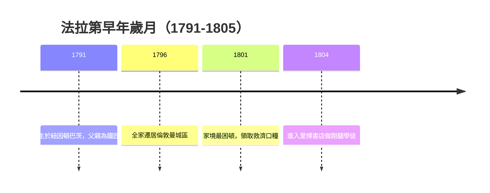

# 1.1 貧困童年與薩里郡歲月

1791年9月22日，麥可・法拉第出生於倫敦南方的紐因頓巴茨（Newington Butts），一個屬於薩里郡的鄉村地帶。父親詹姆斯・法拉第是一名鐵匠，因健康不佳經常無法工作，家境極為清寒。母親瑪格麗特操持家務，一家四口有時必須依靠救濟麵包度日，法拉第後來回憶，幼年時每週的口糧曾少到「一條麵包要吃上整整一週」。這樣的出身在當時的英國幾乎註定了與知識階層無緣。

法拉第只受過最基本的讀寫與算術教育，十三歲左右就必須自食其力。然而家庭雖貧，卻給了他兩樣無價的東西：一是桑德曼教派（Sandemanian）的宗教傳統，強調誠實、互助與對真理的執著，這成為他一生嚴謹誠信的道德底色；二是父親鐵匠鋪裡的勞動氛圍，使他不歧視動手操作，日後他最傑出的能力之一，正是把抽象思想化為精巧實驗。

因果地來看，貧困塑造了法拉第的兩個性格軸線：因為沒有機會接受正式學校教育，他終身保持強烈的自主學習動機；因為早年在底層掙扎，他對功利與虛榮極為淡泊，多次拒絕皇家學會主席職位與爵士封號，選擇以純粹研究者身分度過一生。童年的匱乏不是他故事的背景，而是驅動整部傳記的第一個「初條件」。

## 因果分析

- **家庭貧困** ⟹ 早熟自立的性格與強烈的知識渴望，構成日後自學路線的根本動機。
- **桑德曼教派教養** ⟹ 誠實記錄實驗、不誇大結論的科學品格，影響其《電學實驗研究》的寫作風格。
- **鐵匠鋪環境** ⟹ 對工具與手工的親近感，為「實驗天才」埋下伏筆。

