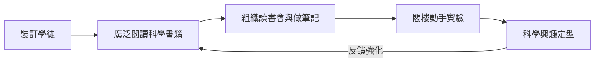

# 1.2 書店學徒與自我教育

1805年，十四歲的法拉第進入倫敦布蘭福德街的里博（George Riebau）書店，先做一年跑腿，隨後簽下七年裝訂學徒約。對一個貧家子弟而言，這只是謀生之道；但命運的巧妙在於：裝訂書的工作讓他整日與書為伴，而學徒的閒暇又允許他閱讀經手的書。書店成了他唯一的「學校」。

法拉第並非漫無目的地讀書。他選擇了兩類書：一是《大英百科全書》（第三版）中的科學條目，二是《心靈的改進》（The Improvement of the Mind）這類談自學方法的書。他依照後者的建議，組織了一個小小的讀書會，與幾位同好輪流朗讀、討論、做筆記。他更開始做實驗：用省下的零錢買簡陋器材，在里博書店的閣樓裡做電化學實驗，用銅板和鹽水重現伏打電堆的效應。老板里博不但不禁止，還默許他在店裡從事這些「怪事」。

從因果結構看，這一階段是「環境供給」與「個人動機」相互驅動的典型：貧困使正規教育不可得 ⟹ 書店提供唯一可得的思想資源 ⟹ 閱讀又激發更強的求知欲 ⟹ 促使他動手實驗 ⟹ 實驗的失敗與成功再回頭強化讀書的針對性。正是這個自激發的循環，把一個裝訂學徒逐步推向科學的邊界。法拉第後來說，他的教育得益於「書、同伴與自己的努力」，三者缺一不可。

## 因果分析

- **裝訂學徒的身分** ⟹ 接觸書籍的機會，替代了學校教育的功能。
- **《心靈的改進》的方法論** ⟹ 系統性筆記與討論會習慣，成為其終身科學方法的核心。
- **閣樓實驗** ⟹ 從閱讀者轉變為實驗者的關鍵一步，直接為進入電學鋪路。

