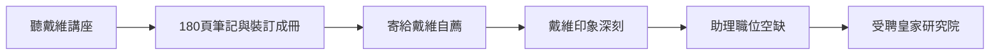

# 2.1 聽戴維演講與筆記本自薦

1812年2月至4月，二十一歲的法拉第坐在皇家研究院的階梯教室裡，聽漢弗萊・戴維的化學講座。戴維是當時英國最耀眼的科學家，以電化學分解鉀、鈉而名滿歐洲。法拉第聽了四次講座，共寫下一百八十頁筆記，配有插圖，並把筆記謄寫、裝訂成一本精美的小書。

學徒生涯即將結束，法拉第面臨抉擇：繼續做裝訂匠，還是設法進入科學界。他做出了改變一生的舉動——把這本筆記寄給戴維，附上一封信，請求給他任何科學相關的工作，哪怕是最卑微的職位。戴維收到後大為驚訝：一個裝訂學徒竟能如此完整、忠實地記錄並理解他的講座。戴維回信客氣地婉拒了，但兩人的聯繫已經建立。

轉機很快到來。1813年初，皇家研究院實驗助理佩恩因毆打同事被解僱。戴維想起了那本筆記，推荐法拉第遞補。有人提醒戴維法拉第出身低微、未受正規教育，戴維回答：「他的化學知識勝過我，筆記就是證明。」1813年3月，法拉第以每週二十五先令的薪水成為實驗助理。

因果上，這一節是全書最重要的轉折點之一：讀書⟹聽講⟹筆記⟹自薦⟹職位，每一步都是前一步的果、下一步的因。它也預示了日後戴維與法拉第之間微妙而矛盾的關係——戴維是伯樂，卻也將成為嫉妒的來源。

## 因果分析

- **講座筆記的品質** ⟹ 成為法拉第唯一可展示的「學歷證明」，替代了學位。
- **戴維的識人之明** ⟹ 打破階層壁壘的直接動力；若無此一決定，法拉第可能終身為工匠。
- **佩恩被解僱** ⟹ 提供了偶然的職位空缺，機遇與準備在此交會。

