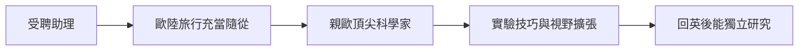

# 2.2 助理與歐洲科學之旅

受聘僅數月後，法拉第迎來一次意外的深造：戴維應邀赴歐洲大陸旅行講學並領取拉沃錫耶勳章，因僕人不肯同行，便帶法拉第充當隨從與實驗助手。1813年10月，兩人啟程，同行還有戴維的新婚夫人。這趟為期一年半的旅程橫跨法國、義大利、瑞士，是法拉第生平第一次離開英國。

旅途中法拉第的收穫遠超一個僕人的本分。他在巴黎親眼見證安培、阿拉戈等法國科學家與戴維的學術交流；在佛羅倫斯，協助戴維用托斯卡尼大公的巨型透鏡燃燒鑽石，證明鑽石純由碳構成；在熱那亞研究電鰩；在日內瓦與化學家德・拉・里夫合作實驗。他寫給妹妹的家書充滿對阿爾卑斯山與維蘇威火山的驚嘆，也夾雜著委屈——戴維夫人堅持要他同桌吃飯卻又以僕人相待，旅途的階級屈辱讓他深刻體會身分的不平等。

從因果角度看，這趟旅行是把「書本知識」升級為「科學共同體經驗」的催化劑：親見歐洲頂尖實驗室與科學家 ⟹ 理解科學是國際性的事業 ⟹ 實驗技巧與視野同步擴張 ⟹ 回英國後足以獨立承擔研究。同時，旅途中的屈辱也轉化為動力，強化了他以成果證明自己的決心。機遇（僕人缺席）與能力（筆記本換來的信賴）再度交會，這是本傳記反覆出現的模式。

## 因果分析

- **隨行歐洲** ⟹ 直接接觸歐陸科學前沿，補足英國視野的局限。
- **實地協助實驗** ⟹ 從旁觀者轉為參與者，實驗自信大增。
- **階級屈辱的經歷** ⟹ 深化其淡泊名利、以科學本身為報償的價值取向。

