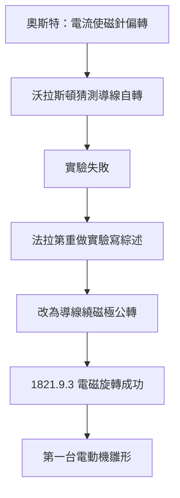

# 3.1 奧斯特發現與電磁旋轉實驗

1820年，丹麥物理學家奧斯特在一次課堂示範中發現：通電導線能使附近的磁針偏轉。這是電與磁首次被證明有聯繫，消息傳遍歐洲，法國的安培迅速建立起電動力學的數學理論。英國方面，沃拉斯頓提出一個猜想：通電導線在磁極附近或許會繞自身軸自轉，但他與戴維的實驗都失敗了。

1821年，應《哲學年鑑》之邀，法拉第撰寫一篇電磁學歷史綜述。為了寫作，他重做了所有關鍵實驗——這正是他的方法：先讀、再重做、後綜述。重做沃拉斯頓的實驗時，法拉第換了一個思路：不要讓導線繞自身軸轉，而是讓導線繞著磁極「公轉」。1821年9月3日，他成功了：水銀槽中，一根通電導線繞磁鐵持續旋轉；反過來，懸掛的磁鐵也能繞通電導線旋轉。這就是人類史上第一台電動機的雛形——電流轉化為連續的機械運動。

這一突破的因果結構耐人尋味：奧斯特發現電生磁 ⟹ 引出「磁能否反過來驅動電流導線」的問題 ⟹ 沃拉斯頓的失敗排除了錯誤路徑 ⟹ 法拉第以「力的橫向作用」的直覺改換幾何配置 ⟹ 電磁旋轉誕生。然而勝利伴隨苦果：有人指責法拉第「竊取」沃拉斯頓的想法，戴維未能公開為他辯護，兩人關係出現裂痕。這次風波迫使法拉第更加自立，也埋下他終身不依附權威的性格。

## 因果分析

- **奧斯特發現** ⟹ 打開電磁學大門，製造全歐洲的競爭壓力。
- **撰寫綜述的任務** ⟹ 提供重做實驗的契機，將寫作壓力轉化為發現動力。
- **沃拉斯頓失敗** ⟹ 排除自轉假設，促成法拉第改採公轉構型的關鍵轉念。

