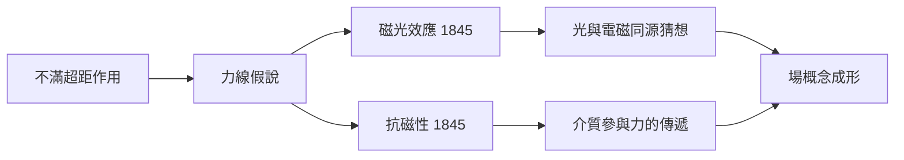

# 4.2 力線、磁光效應與抗磁性

1830年代末，法拉第因過勞與汞中毒（當時實驗普遍使用水銀）健康崩潰，數年間幾乎無法工作。但休養期間，他頭腦中正在醞釀一場概念革命。當時主流的安培—泊松傳統認為，電磁作用是兩物體之間「超距的瞬時力」，空間本身沒有任何角色。法拉第則基於多年的實驗直覺提出：力並非憑空跨越虛空，而是沿著佈滿空間的「力線」傳遞；磁鐵之間的空間並不空，而是「緊張」的。這就是把空間本身變成物理角色的第一步——場概念的雛形。

恢復健康後，法拉第一連串實驗為力線提供了堅實證據。1845年8月，他嘗試尋找磁與光的聯繫：讓偏振光通過置於強磁場中的重玻璃（他二十年前為皇家研究院鑄造的硼酸鉛玻璃終於派上用場），發現偏振面隨磁場方向旋轉。這是史上第一次證明磁力能影響光——法拉第磁光效應（法拉第效應）。同年11月，他進一步發現所有物質都會對磁場產生反應：鐵被強烈吸引（順磁性），而玻璃、鉍、銅等竟被微弱排斥——抗磁性。磁不再是少數「磁體」的專利，而是作用於一切物質的普遍現象。

這些發現的因果意義重大：磁光效應把光拉進電磁王國 ⟹ 暗示光與電磁同源 ⟹ 為「光是電磁波」的猜想提供實驗線索；抗磁性則顯示介質本身參與力的傳遞 ⟹ 支持力線是實在的物理對象 ⟹ 直接壯大「場」的概念。到1846年，法拉第甚至大膽猜想：也許根本沒有「以太」，光是力線的橫向振動。這句猜測在馬克士威手中化為精確的數學。

## 因果分析

- **長期實驗對超距說的不滿** ⟹ 提出力線作為力的載體。
- **舊玻璃標本** ⟹ 成為磁光實驗的關鍵材料，二十年的閒置積累轉化為突破。
- **磁光效應與抗磁性** ⟹ 雙重證據把力線從哲學猜想變為可操作的物理實體。

