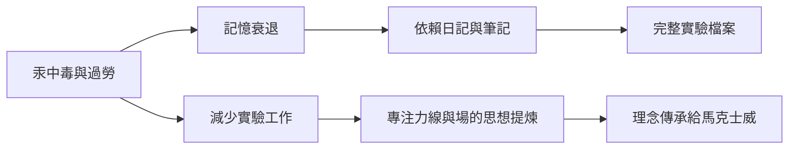

# 5.1 記憶衰退與晚年的堅持

1840年代起，法拉第的健康與記憶開始明顯衰退。長年暴露於水銀蒸氣與過度勞累被認為是主因；他形容自己的記憶像「一張不斷被擦去的黑板」，有時做完演講幾小時後便想不起自己說過什麼。對一個以實驗記錄為生命的人而言，這是殘酷的折磨。他在日記中寫道：「我的一切希望與樂趣，就是在我頭腦尚能工作時把它用於工作。」

然而衰退並未停止他的腳步。1850年代他仍做出重要工作：1855年前後完成《實驗研究》化學卷的整理；持續思考力的統一問題，反覆嘗試尋找重力與電磁的聯繫——雖然實驗皆告失敗，但這個問題在今天仍是物理學最深的未解之謎。1858年，他謝絕出任皇家學會主席的邀請，也謝絕封爵；維多利亞女王賜予漢普頓宮附近的一棟房屋作為晚年居所，他欣然接受這份「不需回報的善意」，繼續出席聖誕講座，與兒童交談。

法拉第的晚年態度可以概括為：在能力遞減中保持意志遞增。記憶衰退 ⟹ 更依賴翔實的筆記與日記 ⟹ 這反過來使他的實驗記錄成為科學史上最完整的個人檔案；健康衰退 ⟹ 減少實驗 ⟹ 轉向概念性的思考與寫作 ⟹ 為力線與場的思想做最後的提煉。1860年代初，他不再發表論文，但理念已交給下一代——其中最重要的繼承者，正是蘇格蘭的年輕人馬克士威。

## 因果分析

- **汞中毒與過勞** ⟹ 記憶衰退，迫使他晚年更重視書面記錄。
- **衰退與記錄習慣的互動** ⟹ 意外造就史上最完整的實驗檔案，成為後人研究的一手寶藏。
- **謝絕榮譽** ⟹ 保持獨立研究者的身分直到最後，完成其一生價值觀的閉環。

