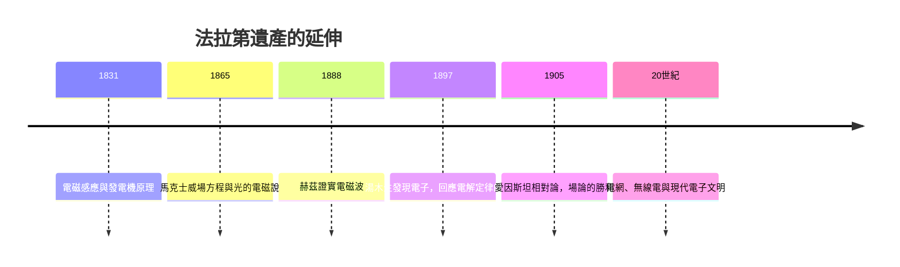

# 5.3 遺產：從發電機到現代文明

1867年8月25日，法拉第在漢普頓宮的書房中安靜離世，享年七十五歲。他生前謝絕葬於西敏寺，選擇長眠於桑德曼教派的海格特墓園，墓碑上只刻著姓名與生卒年。這位拒絕爵士封號、兩度謝絕皇家學會主席職位的人，以最樸素的方式完成了對自己一生價值觀的忠誠。

他的遺產可以分為三層。第一層是技術：電動機與發電機使機械能與電能可以互換，變壓器使遠距輸電成為可能；十九世紀末的電力工業——從愛迪生的直流系統到西門子的電機製造——全部建立在1831年的實驗之上。沒有電磁感應，就沒有電網、電燈與電車，也就沒有二十世紀的城市形態。第二層是科學：電解定律的離散性啟發了電子論；力線與場概念經馬克士威發展為場論，成為二十世紀物理學的語言——狹義相對論與廣義相對論都是場論的後裔，愛因斯坦書房裡掛著法拉第與馬克士威的肖像。第三層是精神：一個裝訂學徒憑自學登上科學之巔，證明天才不在階層之中；而他的誠實記錄、對失敗的坦承、對名利的淡泊，為科學職業倫理立下了標杆。

回望全書的因果長鏈：貧困 ⟹ 書店學徒 ⟹ 《大英百科》與講座 ⟹ 筆記本 ⟹ 戴維門下 ⟹ 電磁旋轉 ⟹ 電磁感應 ⟹ 力線 ⟹ 場概念 ⟹ 馬克士威方程 ⟹ 電磁波 ⟹ 現代文明。每一環都是前一環的果、後一環的因。法拉第的一生告訴我們：歷史的重大轉折，往往始於一個人在恰當的時刻，把微小的準備推進了一步。

## 因果分析

- **電磁感應的實用化** ⟹ 電力工業誕生，人類文明由蒸汽時代邁入電氣時代。
- **場概念的確立** ⟹ 為相對論與量子場論提供概念基礎，重塑物理學的世界觀。
- **個人品格的示範** ⟹ 科學誠信與公眾教育成為科學家職業倫理的範式，影響綿延至今。

