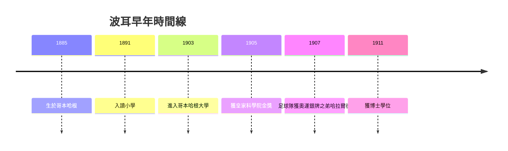

# 1.1 學者家庭與早期教育

1885年10月7日，尼爾斯·波耳出生於哥本哈根一個知識菁英家庭。父親克里斯提安·波耳是哥本哈根大學生理學教授，母親艾倫出身於富有的猶太銀行家家庭。這個「學者之家」每兩週聚集丹麥知識界的重要人物——哲學家霍夫丁、語言學家彼得森、物理學家克里斯蒂安森，輪流討論哲學、科學與文學。少年尼爾斯被允許旁聽，耳濡目染之下，科學與哲學對話成為他一生的思維底色。

家庭環境直接塑造了兩條關鍵因果線。其一：父親讓他在大學實驗室幫忙做生理實驗，培養了他對實驗細節的重視與動手能力；其二：家中關於「心與物」「目的與因果」的哲學辯論，為日後互補原理埋下種子。1903年他進入哥本哈根大學，先讀物理、數學與天文，同時是足球國家隊後衛，其弟哈拉爾德更是國家隊名將。

**因果分析**：丹麥小國缺乏實驗設備，促使波耳日後以理論綜合見長；家庭沙龍的跨學科辯論則使他習慣從認識論高度思考物理問題。沒有這個「哲學化的家庭實驗室」，就不會有後來敢於對抗經典物理直覺的量子詮釋者。學者之家既是他的搖籃，也是哥本哈根學派的精神原型。
