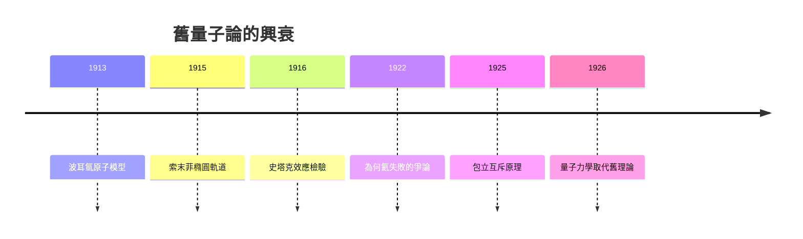

# 2.3 氫原子光譜與舊量子論的成功與局限

波耳模型的驗證來自一個關鍵對比：氫光譜的里德伯常數可由理論計算，且若考慮原子核有限質量（約化質量修正），理論與實驗高度吻合——這一吻合被視為「量子物理戰勝懷疑」的標誌。索末菲隨後引入橢圓軌道與相對論修正，成功解釋氫光譜的精細結構，形成「舊量子論」的黃金時代（1913–1925）。

但局限同樣明顯：模型無法處理氦原子光譜、無法解釋譜線強度與偏振、對反常塞曼效應無能為力。1922年泡利不客氣地說：「波耳模型是騙人的東西。」這些失敗不是白費——它們精確劃出了經典概念的邊界，逼出後續革命：包立的互斥原理（1925）、海森堡矩陣力學（1925）、薛丁格波動力學（1926）。波耳本人始終將舊量子論視為「通往真理的梯子」。

**因果分析**：成功與失敗共同驅動科學進步。氫的成功使量子假設獲得主流地位並促成研究所創建；氦的失敗則暴露半經典方法的根本缺陷，成為新一代（海森堡、包立）起而革命的直接原因。波耳的偉大之處在於：他不但容忍自己理論的失敗，還把失敗轉化為下一代理論的問題清單——失敗即資源。
