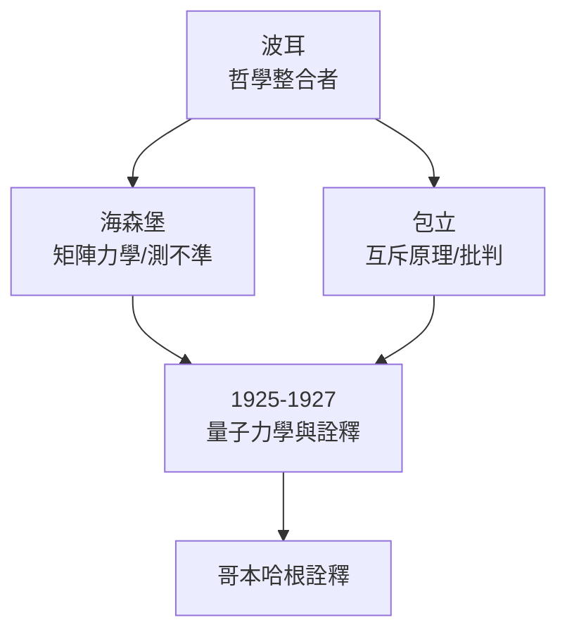

# 3.3 哥本哈根學派與海森堡、包立

1920年代的哥本哈根研究所形成獨特的「學派」現象：波耳不僅是導師，更是討論的催化劑。他說話輕聲、思路迂迴、極度依賴助手記錄整理，常把演講者問到啞口無言；但他從不居高臨下，反而營造「誰都可以被駁倒」的平等氛圍。包立以「物理學良知」著稱，犀利批評推動嚴謹；海森堡1925年在與波耳、約爾丹的合作與衝突中催生矩陣力學；1926年薛丁格來訪，與波耳激辯波動詮釋至病倒。

波耳與包立、海森堡的三角關係是學派的引擎：包立在外部當「毒舌審稿人」，海森堡在內部當「先鋒突擊隊」，波耳則是「哲學整合者」。費米、狄拉克、朗道、奧本海默也先後造訪，形成世界量子力學的樞紐。

**因果分析**：學派不是靠權威維繫，而是靠「衝突制度化」——波耳刻意讓天才互槓，使錯誤觀點在辯論中快速死亡、正確觀念快速結晶。測不準原理的誕生即是波耳與海森堡激烈爭論的產物：海森堡最初忽略波動性，被波耳逼著修正。無此組織形式，量子力學的哲學基礎未必在數年內成型。
