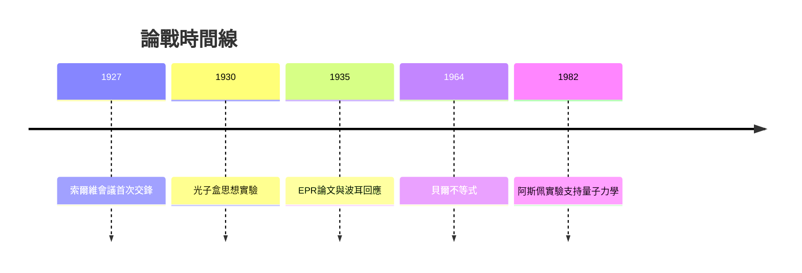

# 4.2 與愛因斯坦的論戰

1927年索爾維會議開啟波耳與愛因斯坦長達近三十年的論戰。愛因斯坦不接受「放棄對個別系統作完整因果描述」，會議期間設計單縫、雙縫等思想實驗企圖證明量子力學不完備；波耳每次都以「你的裝置本身服從測不準關係」化解。1930年愛因斯坦提出著名的光子盒思想實驗：以彈簧秤與快門精確同時測光子能量與時間，似可擊穿 $\Delta E\,\Delta t$ 關係。波耳徹夜苦思，最後用愛因斯坦自己的廣義相對論（引力紅移使秤讀數不確定）反敗為勝。

1935年愛因斯坦與波多爾斯基、羅森發表EPR論文，提出「量子糾纏」證明量子力學若完備則必須承認「幽靈般的超距作用」。波耳的回應是：兩個粒子不再能視為分開的子系統，「現象」是整體實驗情境的屬性。1960年代貝爾不等式與之後的實驗（阿斯佩等）證實量子力學預測正確——論戰在實驗上以愛因斯坦的直覺落敗告終，但EPR概念催生了今日量子資訊科學。

**因果分析**：論戰是「批判驅動精煉」的典範。愛因斯坦每一次攻擊都迫使哥本哈根詮釋更精確地劃清概念邊界；而詮釋的清晰化又促使愛因斯坦提出更精巧的實驗。雙方立場對立，科學成果卻同源——EPR的「失敗」孕育了糾纏物理與量子資訊。論戰不是消耗，而是量子力學的壓力測試。
