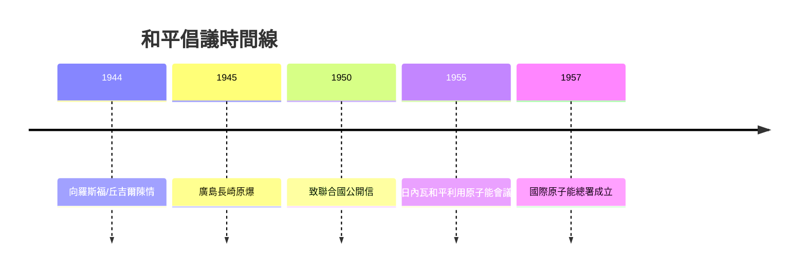

# 5.2 開放世界：和平倡議

早在1944年，原子彈尚未試爆，波耳已向羅斯福與丘吉爾陳情：核武器的存在使各國無法保守秘密，唯有國際開放與互相監督才能避免核競賽。這份「開放世界」（Open World）備忘錄的邏輯是：既然物理定律不可能長期保密，秘密軍備必導致猜疑與軍備競賽，因此制度性透明是唯一穩定解。然而丘吉爾視他為危險的泄密者，羅斯福也態度冷淡，遊說失敗。

戰後波耳並未放棄。1950年他發表《致聯合國的公開信》，主張各國原子能計畫完全開放、設立國際監督機構。這些理念超前於時代，卻與後來的國際原子能總署（1957）及軍控談判的核查機制精神相通。1955年他主持第一屆日內瓦和平利用原子能會議的丹麥代表團，推動核能的民用方向。

**因果分析**：倡議的因果起點是曼哈頓計畫的親身經歷——「知情者才懂得恐懼」。遊說失敗的原因同樣是因果性的：1944年盟軍仍視原子彈秘密為戰略優勢，開放提案不合時宜；但戰後核競賽的展開反而證明了他的預判。個人的挫敗與歷史的驗證構成時差因果：正確的理念在錯誤的時間提出，卻塑造了數十年後的制度設計。
