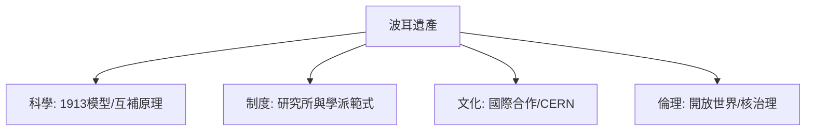

# 5.3 晚年、逝世與科學遺產

戰後波耳重返重建的哥本哈根研究所，推動成立北歐理論原子物理研究所（NORDITA，1957），繼續召集各國學者。晚年的他系統性整理互補原理，撰文論及物理學與生物學、語言、文化的關係，並積極參與歐洲科學合作，是最早呼籲成立類似歐洲核子研究組織（CERN）跨國實驗室的倡議者之一，丹麥對CERN的參與由他促成。1962年11月18日，波耳在哥本哈根家中於午睡時安詳去世，享年七十七歲。

他的遺產可分四層：科學上，1913原子模型與互補原理奠基了原子物理與量子詮釋；制度上，哥本哈根研究所成為「國際科學中心」的範式；文化上，「哥本哈根學派」證明小國可以透過開放合作成為科學樞紐；倫理上，開放世界理念預見了核時代的治理邏輯。元素第107號「𨨏（Bohrium）」以其為名。

**因果分析**：本書各章的因果長鏈在此收束：學者之家 → 拉塞福師承 → 1913模型 → 研究所 → 哥本哈根詮釋 → 論戰淬鍊 → 核時代流亡 → 和平倡議 → 永久遺產。每一環既是上一環的果，又是下一環的因。波耳一生的核心方法論一以貫之：在矛盾中不選邊，而創造能容納對立面的更大框架——這既是量子詮釋，也是他對世界秩序的想像。
