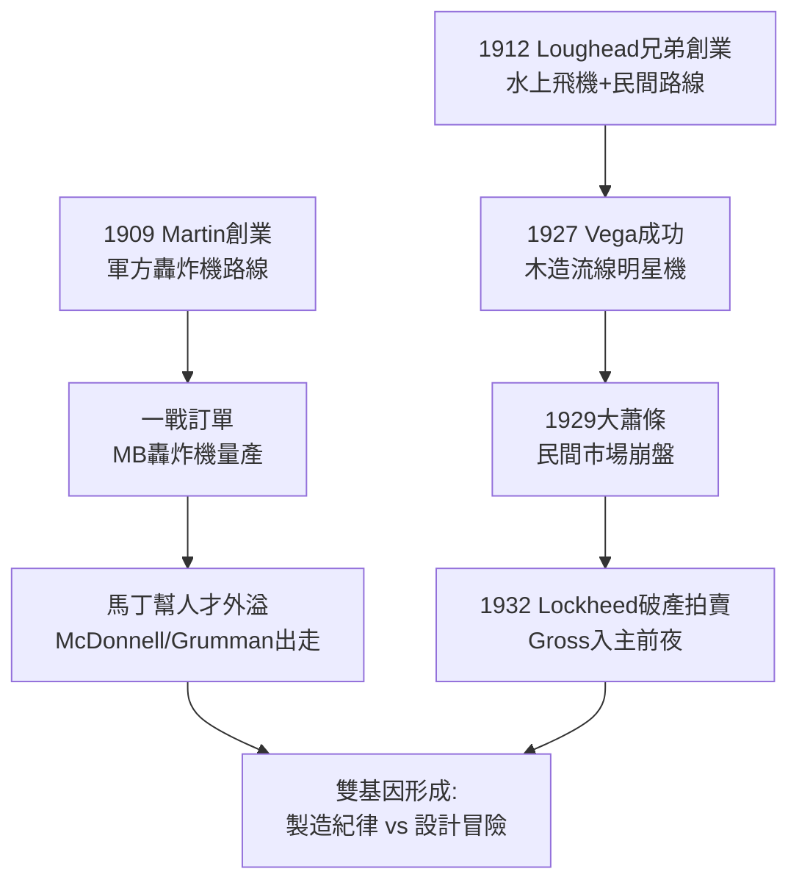

# 1.1 展翅之初：馬丁與洛克兄弟 (1909-1932)

> 本節時間：1909–1932。兩條看似平行的創業線——Glenn L. Martin 的穩健工程與 Allan、Malcolm Loughead（Lockheed）兄弟的冒險木造飛機——如何在第一次世界大戰、戰後泡沫與大蕭條前夜交錯，最終為日後的「洛克希德·馬丁」埋下雙重基因。

## 一、Glenn Martin：美國航空的教父

1909 年，Glenn Luther Martin（1886–1955）在加州聖安娜駕駛自己設計的飛機升空，成為美國最早的飛行器製造者之一。1912 年，他在洛杉磯創立 **Glenn L. Martin Company**。

馬丁的風格是典型的工程師—企業家：

- 重視生產方法與軍方訂單，不追逐單一明星機種；
- 一戰期間為美國陸軍生產 MB-1、MB-2 轟炸機，成為首家大規模交付雙引擎轟炸機的美國廠商；
- 培養了後來美國航空業的「馬丁幫」：James McDonnell（麥道創辦人）、Leroy Grumman（格魯曼創辦人）、Curtiss-Wright 的高層，多出自馬丁門下。

用一句話概括：**馬丁是航空工業的黃埔軍校**，輸出人才與製造紀律，而非單一傳奇產品。

## 二、洛克兄弟：Loughead 到 Lockheed

另一條線更為曲折。1912 年，Allan Loughead（1889–1969）與兄長 Malcolm Loughead 在舊金山創立 **Alco Hydro-Aeroplane Company**，製造水上飛機。為迎合英文發音，後將姓氏拼法改為 **Lockheed**（讀音不變）。

- 1916 年改組為 Loughead Aircraft Manufacturing Company；
- 1918 年推出 F-1 水上飛機，曾創下舊金山—聖地牙哥長途飛行紀錄；
- 但一戰結束後軍方訂單斷崖式取消，公司於 1921 年倒閉。

1926 年，在投資人 Fred Keeler 出資下，Allan Lockheed 與 Jack Northrop（後創辦諾斯洛普）在好萊塢重建 **Lockheed Aircraft Company**。1927 年推出的 **Vega** 木造單翼機，以流線型膠合板殼體（monocoque）聞名，被 Amelia Earhart、Wiley Post 等傳奇飛行家選用，一度成為速度與航程的代名詞。

然而好景不長：1929 年大蕭條重創私人航空市場，Lockheed 於 1929–1931 年瀕臨破產，最終被 Detroit Aircraft 控股，又隨母公司於 1932 年破產拍賣。這正是下一節主角 Robert Gross 登場的前夜。

## 三、雙源頭的對照

| 維度 | Glenn Martin (1909–) | Lockheed (1912/1926–) |
|---|---|---|
| 核心客戶 | 陸軍、海軍轟炸機 | 民間競速、探險飛行 |
| 技術路線 | 金屬結構、量產工藝 | 木造流線、氣動外形 |
| 組織文化 | 穩健、師徒制 | 冒險、明星設計師制 |
| 財務命運 | 一戰紅利後持盈保泰 | 大起大落、兩度破產 |

這種差異極為關鍵：馬丁代表「系統與製造」，洛克希德代表「速度與設計」。1995 年的合併，實質上是這兩種基因時隔八十年的重逢。

## 因果鏈

**前因驅動：** 一戰創造了美國軍用航空市場（前因），使馬丁得以靠轟炸機立足；而戰後剩餘物資傾銷與 1920 年代民間探險熱（前因），則把 Lockheed 推向競速明星機的利基市場。這兩種不同的「第一桶金」來源，塑造了兩家公司迥異的組織性格。

**後果引發：** Lockheed 1932 年的破產並非終點，而是篩選機制——它清除了投機資本，為 Robert Gross 以低價接手、引入華爾街金融紀律鋪路（後果）；馬丁的人才外溢則間接催生了麥道、格魯曼等未來競爭者（後果），使美國航空業從 1930 年代起就處於馬丁系譜的內部競爭之中。這兩條因果線，將在 L-10 Electra 與 P-38 身上匯合。
