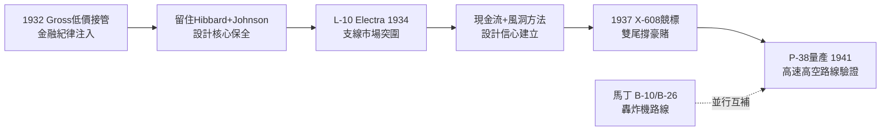

# 1.2 Electra 與 P-38：大蕭條中的技術突圍 (1932-1941)

> 本節時間：1932–1941。破產拍賣會上的 Lockheed 如何在 Robert Gross 主導下重生，以 L-10 Electra 打開民航市場，又以 P-38 Lightning 的雙尾撐布局押注未來戰爭。

## 一、Robert Gross 的接管：金融家拯救工程師

1932 年，財團經理人 Robert E. Gross（1897–1961）以 4 萬美元買下 Lockheed 全部資產。當時公司帳面上幾乎只剩圖紙與一間破廠房。

Gross 做了三件關鍵事：

1. **引進華爾街資本與成本會計**，終結此前藝術家作坊式經營；
2. **留住天才設計師 Hall Hibbard 與年輕的 Kelly Johnson**（時年 23 歲，剛從密西根大學畢業）；
3. **賭民航復甦**：當波音 247、道格拉斯 DC-2 壟斷幹線時，Lockheed 瞄準支線與企業市場的空隙。

結果是 1934 年首飛的 **L-10 Electra**（伊萊克特拉）：雙引擎、全金屬下單翼、可收放起落架、10 人座。其氣動設計大量出自 Kelly Johnson 之手，風洞測試時數是同級機的數倍。

Electra 雖未擊敗 DC-3，卻以優異的操控與速度贏得中小航空公司與軍方訂單，並衍生出 L-12、L-14，連 Amelia Earhart 環球飛行選用的也是 L-10E 特別型。Lockheed 由此轉虧為盈，員工人數從 1933 年的不到百人增至 1939 年的逾 7000 人。

## 二、P-38 Lightning：為戰爭而生的異類

1937 年，美國陸航提出截擊機需求（X-608）：高速、爬升率、高空性能。Kelly Johnson 交出的答案離經叛道——**雙引擎、雙尾撐（twin-boom）、中央短艙**的 P-38。

- 時速超過 $640\,km/h$ ，為當時美國陸軍最快戰機；
- 渦輪增壓器使其高空性能卓越，航程遠超 P-39、P-40；
- 集中機頭的 4 挺機槍 + 1 門機炮，彈道集中，火力密度驚人。

P-38 的開發曆經顫振、壓縮性（compressibility）導致的高速俯衝失控等難題，Johnson 團隊以電梯式襟翼（dive flap）逐一破解。這種「發現問題—快速迭代」的模式，成為日後臭鼬工廠（Skunk Works）工作法的雛形。

到 1941 年珍珠港事變前，P-38 已投產，成為美國陸航寄予厚望的遠程戰機。而在太平洋戰場，它將擊落山本五十六座機，一戰成名。

## 三、馬丁的同期：B-10 與 B-26

同期的 Glenn Martin 公司則憑 **B-10**（1932）開創全金屬單翼轟炸機時代，一度快過任何戰鬥機，獲 1932 年 Collier Trophy；後續 **B-26 Marauder** 雖因高翼負荷惡名昭彰（寡婦製造者），卻在戰術轟炸中找到定位。

換言之，1930 年代末：**洛克希德押注速度與高度，馬丁押注載彈與航程**，兩者互補而非重疊。

## 因果鏈

**前因驅動：** 沒有 1932 年破產導致的資產賤賣（前因），Gross 無法以極低成本取得控制權；沒有 Electra 在支線市場的現金流（近因），Lockheed 無力支撐 P-38 這種高風險雙發重戰機的長期研發。技術上，Electra 驗證的全金屬應力蒙皮與風洞方法，直接遷移到 P-38。

**後果引發：** P-38 的渦輪增壓、高空、長航程經驗，使 Lockheed 在 1943 年被陸軍點名開發噴射戰機 XP-80（後果），直接催生臭鼬工廠；其量產組織經驗（分包、總裝線）則為二戰期間伯班克（Burbank）大擴張提供了管理模板（後果，見 1.3）。馬丁的轟炸機路線亦為其戰後轉向大型飛機與飛彈奠定基礎。
