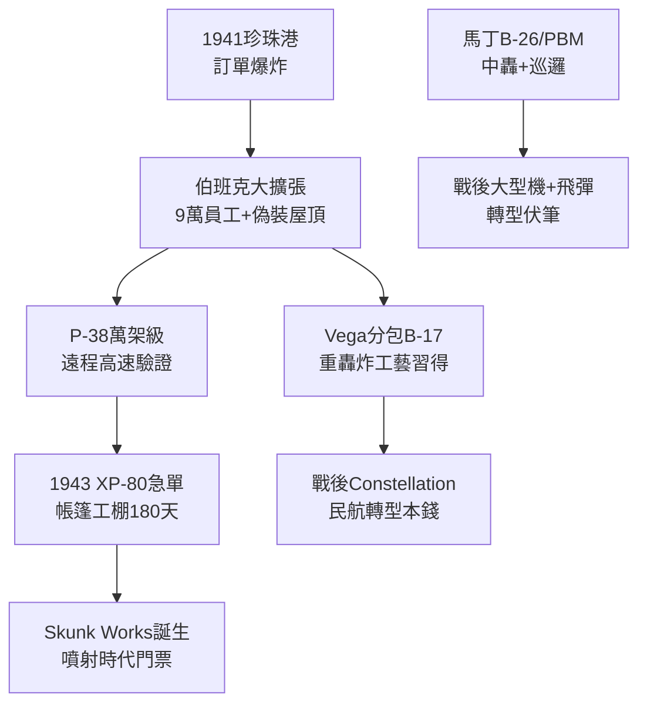

# 1.3 戰爭機器：二戰量產與伯班克奇蹟 (1941-1945)

> 本節時間：1941–1945。二戰如何把兩家中等規模飛機商推上軍工主舞台：Lockheed 生產近 1 萬架 P-38 與 B-17、B-29 分包，馬丁生產 B-26 與巡邏機，並共同捲入曼哈頓計畫外圍與噴射時代前夜。

## 一、伯班克：從小廠到城市工廠

珍珠港事變時 Lockheed 員工約 1 萬人，到 1943 年底暴增至 9 萬人。伯班克廠房連綿數公里，為防空襲甚至在屋頂鋪設偽裝網、漆上農田圖案，從空中俯瞰宛如郊區（著名的「伯班克偽裝」）。

產量：

- **P-38 Lightning：約 10,037 架**，太平洋與地中海戰場主力；
- **B-17 飛行堡壘分包（與道格拉斯、維加聯合組成的 BVD 聯盟）**：Lockheed 子公司 Vega 生產約 2,750 架 B-17；
- PV-1 Ventura / PV-2 Harpoon 海上巡邏機約 3,000 架；
- 另為 PV 工程累積的機體經驗，轉化為戰後 Constellation 客機的基礎。

生產公式可寫為： $產能 = 廠房面積 \times 女工比例 \times 分包網絡$ 。Lockheed 大量僱用「鉚釘女工」（Rosie the Riveter），女性占比一度超過 40%，流水線節拍壓縮至以小時計。

## 二、馬丁的戰爭：B-26 與 PBM Mariner

Glenn Martin 公司戰時重心在巴爾的摩（Baltimore）：

- **B-26 Marauder：約 5,288 架**，儘管早期事故率高，經加長翼展改良後在歐洲低空精確轟炸中表現優異，戰損率反而全戰區最低之一；
- **PBM Mariner 水上巡邏轟炸機：約 1,366 架**，大西洋反潛與太平洋搜救主力；
- 另參與 B-29 分包部件與滑翔機製造。

馬丁的貢獻不在明星戰機，而在**可靠的中型轟炸與海上巡邏能量**，這使其戰後自然滑向反潛機（P-2 Neptune、P-3 Orion 的前身譜系由洛克希德繼承，但馬丁亦有深厚積累）與大型水上飛機。

## 三、戰爭的隱性遺產：XP-80 與噴射門票

1943 年，德國 Me 262 的情報促使美國陸軍緊急招標噴射戰機。Lockheed 承諾 180 天交機，Kelly Johnson 在伯班克租用帳篷旁的臨時工棚，組建後來名揚天下的 **Skunk Works** 原型團隊，造出 **P-80 Shooting Star**（見 2.1）。

換言之，二戰結束時，Lockheed 已同時握有三張門票：**重戰機（P-38）、重轟炸分包（B-17）、噴射機（P-80）**；馬丁則握有**中型轟炸機與水上飛機＋製造管理**門票。冷戰一起，兩者都將被推向更高、更快、更遠的競賽。

## 因果鏈

**前因驅動：** P-38 的高速氣動與渦輪增壓知識（前因，見 1.2）使陸軍相信 Lockheed 能搞定噴射機；B-17 分包帶來的重型機結構與品管經驗（前因），讓 Vega 團隊有能力在 180 天內造出 P-80。若無二戰的訂單洪水，Lockheed 不可能養起 9 萬人大廠與分包網絡。

**後果引發：** 伯班克的量產體制與女性勞動力動員，直接外溢為戰後 Constellation 的生產線（後果）；XP-80 的帳篷模式制度化為臭鼬工廠，成為 U-2、SR-71 的組織母體（後果，見 2.1）；馬丁的中轟與巡邏機經驗，則驅使其在 1950 年代轉向 Viking、Titan 等飛彈與太空載具（後果，見 3.3）。戰爭是放大器，也是分岔點。
