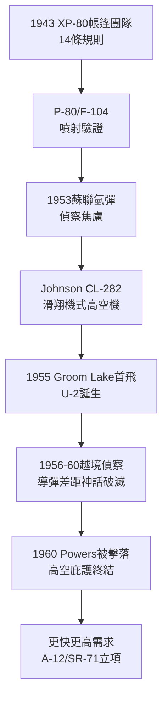

# 2.1 臭鼬工廠的誕生：Kelly Johnson 與 U-2 (1943-1957)

> 本節時間：1943–1957。從伯班克帳篷旁的「臭鼬工廠」到 21,000 公尺高空的 U-2：Kelly Johnson 如何把「小團隊、高授權、快速迭代」變成美國冷戰偵察的王牌。

## 一、Skunk Works：規則的反叛

1943 年 XP-80 急單催生了臭鼬工廠（Skunk Works，正式名 Advanced Development Projects）。領導者 Clarence "Kelly" Johnson（1910–1990）立下著名的 **14 條規則（Kelly's 14 Rules）**：

- 專案經理全權、人數極少（幾十人而非幾千人）；
- 客戶直接對接工程師，跳過官僚層；
- 圖紙與製造現場同地，邊造邊改；
- 嚴格保密、成本與時程同為性能指標。

名稱由來：工人戲稱臨時工棚臭如漫畫《Li'l Abner》中的 "Skonk Works" 釀酒廠，遂以 Skunk Works 為號。此後它成為「高度機密快速原型」的代名詞。

P-80（1944 首飛，美國第一種實用噴射戰機）、F-104 Starfighter（1954，2 倍音速、日後「寡婦製造者」但外銷極佳）皆出自此團隊，驗證了模式的有效性。

## 二、U-2：高空中的眼睛

1953 年韓戰後，美國急需穿透蘇聯領空偵察核武部署。空軍要求能在 $21,000\,m$ 以上巡航、航程 $8,000\,km$ 的偵察機——當時無人相信可行。

Johnson 的 CL-282 方案：超長展弦比滑翔機式機翼＋輕結構＋一具 J57 發動機，1955 年以 **U-2** 之名在內華達 Groom Lake（後來的 51 區）秘密試飛，從立項到首飛僅約 8 個月。

- 1956–1960 年 U-2 多次飛越蘇聯，拍回導彈基地、核設施照片，直接影響艾森豪威爾對「導彈差距」的判斷；
- 1960 年 5 月 1 日 Francis Gary Powers 駕 U-2 在斯維爾德洛夫斯克被 SA-2 擊落，引發巴黎峰會破局——證明高空亦非永恆庇護；
- 1962 年古巴飛彈危機，U-2 拍到 SS-4 基地照片，成為甘迺迪決策的關鍵證據。

U-2 的成功公式： $情報價值 = 高度 \times 解析度 \times 政治可否認性$ （塗去軍徽、偽裝成氣象機）。

## 三、連鎖反應：從戰術到戰略

U-2 證明「技術突襲可抵償數量劣勢」，中央情報局（CIA）遂成為臭鼬工廠的最大金主，A-12/SR-71（見 2.2）即由此而來。同時，U-2 計畫的 Groom Lake 基地、空中加油與高空壓力服技術，全部成為黑鳥計畫的墊腳石。

## 因果鏈

**前因驅動：** P-38 的高速氣動與 XP-80 的 180 天神話（前因）給了 CIA 信任臭鼬工廠的理由；蘇聯 1953 年氫彈試爆與轟炸機閱兵誇示（前因）製造了「不知敵情」的恐慌，國會願為黑預算開綠燈。沒有這兩者，CL-282 這種外形怪異的滑翔機式設計不可能擊敗正規空軍方案。

**後果引發：** U-2 的情報紅利（後果）直接養大了 CIA 航空部門與 Groom Lake 體系；1960 年被擊落的教訓（後果）證明「高度不夠，要速度＋隱身」，驅動 A-12 以 3 倍音速＋低雷達截面接棒（見 2.2）；古巴危機的照片政治學，更讓「偵察—決策」鏈條成為此後所有戰略偵察機的正當性來源。
