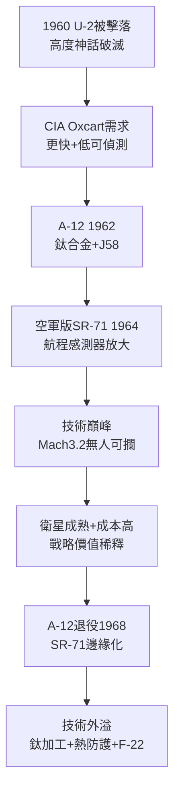

# 2.2 三倍音速：SR-71 黑鳥與 A-12 (1958-1968)

> 本節時間：1958–1968。U-2 被擊落之後，美國把賭注加到 $Mach\,3+$：鈦合金、J58 變循環發動機、吸波塗料——SR-71 黑鳥如何成為人類迄今最快的實用噴射機，又為何快到無用武之地。

## 一、從 A-12 到 SR-71：CIA 與空軍的雙線

1960 年 Powers 事件後，CIA 要求更快、更高、更難被發現的後繼機。臭鼬工廠提出 **A-12 Oxcart**：

- 85% 結構用鈦合金（當時美國鈦產能不足，竟經第三國從蘇聯進口）；
- Pratt & Whitney J58 發動機，在高速時大部分推力來自衝壓效應；
- 機身外形扁平、傾斜垂尾＋吸波材料，降低雷達截面——匿蹤的史前史。

A-12（1962 首飛，CIA 操作）可達 $Mach\,3.2$、$26,000\,m$，從未被擊落。空軍版放大為截擊型 YF-12（曾創速度紀錄）與偵察型 **SR-71 Blackbird**（1964 首飛，1968 服役），雙座、航程更遠、感測器更全。

SR-71 的數據至今令人咋舌：巡航 $Mach\,3.2$、機頭蒙皮 $300^\circ C$ 以上、燃油在地面會滲漏（升空受熱膨脹才密封）、飛行員穿類太空服。蘇聯 MiG-25 專為攔截它而生，卻從未成功攔截過一次。

## 二、技術之巔，戰略之困

然而黑鳥生不逢時：

1. **衛星崛起**：CORONA 鎖眼（Keyhole）偵察衛星 1960 年代成熟，不冒飛行員風險即可覆蓋蘇聯；
2. **成本高昂**：每飛行小時耗資數萬美元，需專用加油機（KC-135Q）與特殊 JP-7 燃料；
3. **政治敏感**：越境偵察易引發外交風暴，尼克森、卡特政府寧用衛星。

結果：A-12 於 1968 年退役（僅 13 架），SR-71 雖服役至 1990 年（後 1995 年短暫復出），實戰偵察架次遠少於 U-2。快到極致，卻快到邊緣化。

但技術外溢巨大：鈦合金加工、衝壓—渦輪複合循環、熱防護、電子對抗，全部流入後來的 F-22、F-35 與太空計畫。黑鳥是「賠錢的學校」。

## 三、馬丁的同期：高空之外的競賽

同一時期，Glenn Martin 公司已於 1957 年與 American-Marietta 合併為 **Martin Marietta**，重心轉向 Titan 洲際導彈與太空（見 3.3）。換言之，1960 年代：**洛克希德飛向大氣層邊緣，馬丁挖向地下發射井與外太空**——兩條高線互不相交，卻在 1995 年合併時恰好拼成「空—天—地」全譜系。

## 因果鏈

**前因驅動：** U-2 被 SA-2 擊落（直接前因）＋蘇聯防空網加密（結構前因），迫使設計從「更高」轉向「更快＋更難看見」；Powers 事件的外交代價（政治前因）則讓 CIA 願意為鈦合金與特種燃料支付任何溢價。

**後果引發：** 黑鳥的「快而貴」教訓（後果）使 1970 年代美國轉向「看不見而非跑得快」——即匿蹤革命（見 3.1）；其低雷達截面試驗（後果）直接為 Have Blue/F-117 提供了吸波材料與外形經驗；而衛星替代有人偵察的趨勢（後果），則把洛克希德的戰略重心推向太空載具與電子系統，為兼併馬丁·瑪麗埃塔的太空資產埋下需求動機。
