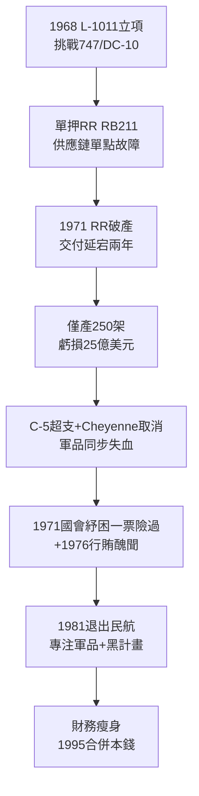

# 2.3 三星隕落：L-1011 與洛克希德破產危機 (1968-1977)

> 本節時間：1968–1977。能造出黑鳥的公司，為何差點被一架客機拖垮？L-1011 TriStar 的發動機賭局、行賄醜聞與 1971 年聯邦紓困，揭示軍工跨足民航的致命陷阱。

## 一、L-1011：技術卓越的商業災難

1960 年代末，洛克希德以軍機利潤押注寬體客機 **L-1011 TriStar**，對撼波音 747 與道格拉斯 DC-10。其技術其實出色：

- 全球首款具備自動著陸（autoland）能力的寬體機；
- S-duct 中央發動機布局，噪音低、安全性高；
- 羅爾斯·羅伊斯 RB211 大涵道比發動機，省油先進。

致命錯誤在供應鏈：洛克希德將命運繫於單一發動機商勞斯萊斯。1971 年勞斯萊斯破產（RB211 超支），L-1011 交付延宕近兩年，DC-10 搶占市場先機。等 L-1011 於 1972 年交付時，損益平衡點（約 500 架）已遙不可及——最終僅生產 250 架，虧損逾 25 億美元（當年幣值）。

公式：$民航利潤 = 交付數量 \times 學習曲線 - 發動機延遲罰金$，洛克希德三項皆輸。

## 二、雙重打擊：軍方合約與行賄醜聞

同期軍品亦受挫：

- C-5 Galaxy 巨型運輸機成本暴漲（超支 20 億美元），空軍改採固定價格合約，虧損由廠商承擔；
- AH-56 Cheyenne 武裝直升機被取消；
- 1971 年公司瀕臨破產，靠美國國會《緊急貸款擔保法》（2.5 億美元擔保）在參議院僅以一票之差通過才倖存。

1975–1976 年更爆發**洛克希德行賄醜聞**：為推銷 F-104、L-1011，向日本、西德、荷蘭、義大利政要行賄。日本田中角榮首相因此下台，美國催生《反海外腐敗法》（FCPA, 1977）。公司聲譽跌至谷底，董事長 Daniel Haughton 引咎辭職。

## 三、為何是轉機？收縮即生存

諷刺的是，破產邊緣迫使洛克希德做出日後救命的選擇：

1. **退出民航**：1981 年停產 L-1011，專注軍機、太空與電子，從此不再與波音正面對決；
2. **擁抱黑計畫**：Have Blue/F-117（見 3.1）正是在公司最窮時以小團隊低成本啟動，反因官僚收縮而少了掣肘；
3. **等待整併**：財務脆弱使其在 1990 年代冷戰結束的整併潮中成為被併方而非主導者？不——恰因軍品純粹、負擔甩掉，反能以平等姿態與馬丁·瑪麗埃塔合併。

馬丁·瑪麗埃塔同期則因專注飛彈太空、早早退出整機民航，財務穩健得多——兩者互補性在 1970 年代已然顯現。

## 因果鏈

**前因驅動：** C-5 固定價格合約的虧損結構（前因）＋寬體客機三強相爭的產能過剩（前因），使 L-1011 從一開始就站在懸崖邊；單一發動機商策略（決策前因）則把懸崖變成深淵。行賄醜聞表面是道德事件，深層是民航滯銷倒逼的 desperation（絕望式行銷）。

**後果引發：** L-1011 的慘敗（後果）直接導致洛克希德永久退出民航整機，確立「軍品＋太空＋電子」的純粹路線——這正是 1995 年馬丁·瑪麗埃塔願意合併的前提（互補而非重疊）；FCPA 立法（制度後果）重塑了美國軍售合規體系；而財務紀律的血的教訓（後果），則成為 F-117、F-22 時代「黑預算＋里程碑付款」合約文化的反面教材。
