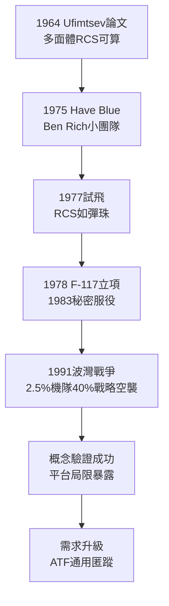

# 3.1 夜鷹降臨：Have Blue 與 F-117 (1975-1989)

> 本節時間：1975–1989。從蘇聯數學家 Ufimtsev 的論文到巴格達上空的夜鷹：一群不到 50 人的臭鼬工廠團隊，如何用「多面體＋吸波塗料」讓飛機在雷達上小如彈珠。

## 一、一篇蘇聯論文點燃的革命

1964 年，莫斯科無線電工程師 Pyotr Ufimtsev 發表《邊緣波繞射的物理理論》，給出計算多面體雷達截面（RCS）的近似方法。美國洛克希德數學家 Denys Overholser 讀到英譯本後意識到：**若把飛機做成全由小平面的多面體，即可精確預言並最小化回波**。

1975 年 DARPA 發起「Harvey」計畫（Have Blue），臭鼬工廠在 Ben Rich（接替 Johnson）領導下造出兩架驗證機：

- 外形如鑽石切面，全機傾斜、無曲面；
- 吸波鐵氧體塗料＋內埋武器艙；
- 氣動極不穩定，靠四餘度電傳飛控硬撐。

1977–1978 年試飛證明 RCS 降至約 $0.001\,m^2$ （相當於一顆彈珠），雷達操作員以為是鳥群。空軍大喜，1978 年授出 F-117 全尺寸開發合約，要求 1981 年形成戰力——對抗蘇聯在中歐的密集防空網。

## 二、F-117：看不見的戰爭

**F-117 Nighthawk**（夜鷹）1977 年立項、1981 年首飛、1983 年秘密服役，59 架量產機全部駐內華達 Tonopah，要求飛行員白天不得外出（以掩人耳目）。

- 1989 年巴拿馬「正義之師」首戰；
- 1991 年波灣戰爭一戰封神：僅占聯軍戰機 2.5%，卻執行 40% 的戰略空襲，投擲 2,000 噸雷射導引炸彈而無一損失；
- 外形科幻，成為流行文化中的「隱形戰機」代名詞。

但代價是性能犧牲：次音速、無空戰能力、載彈僅 2 噸、維護塗料極繁瑣。F-117 證明的是**概念**（匿蹤可實戰），而非**平台**（該平台本身局限極大）。

## 三、驅動 ATF：從特化到通用匿蹤

F-117 的成功與局限，共同驅動了下一代需求：**既要匿蹤，也要超音速機動**——即先進戰術戰機 ATF（見 3.2）。同時，F-117 的黑預算管理（ compartmentalization，區隔化）成為五角大廈範本：小步快跑、先驗證後量產，與 L-1011 的豪賭形成鮮明對比。

## 因果鏈

**前因驅動：** SR-71 的低可偵測試驗＋吸波材料（技術前因）使 Have Blue 不必從零開始；1973 年贖罪日戰爭中以色列空軍被蘇聯 SAM 大量擊落（戰場前因），讓美國空軍相信「速度＋電子干擾已不夠，必須隱身」；洛克希德破產後的收縮（組織前因）反而保住了小而精的臭鼬工廠。

**後果引發：** F-117 的實戰神話（後果）為 ATF/F-22 爭取到國會預算正當性（見 3.2）；其多面體方法的氣動代價（後果）則驅動計算電磁學進步，使 B-2、F-22 得以採用連續曲面匿蹤；黑預算成功（制度後果）更鞏固了臭鼬工廠「先斬後奏」的特權，為日後 F-35 的聯合計畫辦公室（JPO）模式提供了反面參照。
