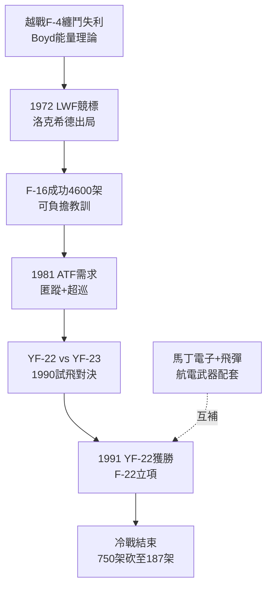

# 3.2 輕戰機到猛禽：F-16 競標與 ATF 計畫 (1972-1991)

> 本節時間：1972–1991。從越戰教訓到冷戰終章：洛克希德如何在輕型戰機（F-16）中落敗卻學到教訓，又在 ATF 中以 YF-22 擊敗諾斯洛普 YF-23，拿下 F-22 猛禽——美國最後的純空優匿蹤戰機。

## 一、越戰的教訓：能量機動與輕戰機

越戰中 F-4 Phantom 被 MiG-17/19 纏鬥擊落的恥辱，催生 John Boyd 的**能量機動理論**（ $P_s = V(T-D)/W$ ）：戰機優劣不在極速而在能量保持。1972 年空軍發起輕型戰機（LWF）競標，通用動力 YF-16（邊條翼＋電傳＋座艙氣泡罩）擊敗諾斯洛普 YF-17，洛克希德的 CL-1200 方案早早出局。

洛克希德的失敗有深意：臭鼬工廠沉迷黑科技（高空高速），對「便宜、靈活、白天纏鬥」缺乏興趣。但通用動力 F-16 的成功（至今生產逾 4,600 架）證明**成本—數量**邏輯的威力，也為日後洛克希德在 JSF 中主打「可負擔匿蹤」埋下伏筆。諷刺的是，洛克希德日後恰靠收購通用動力沃斯堡廠（1993）間接「買回」了 F-16。

## 二、ATF：YF-22 對 YF-23

1981 年空軍提出先進戰術戰機（ATF）需求：匿蹤＋超音速巡航（supercruise）＋短距起降前線部署，對抗蘇聯 Su-27/MiG-29。兩隊入圍：

- **Lockheed＋Boeing＋General Dynamics：YF-22**（二維向量噴嘴、四垂尾布局）；
- **Northrop＋McDonnell Douglas：YF-23**（更匿蹤、更快，但機動稍遜、風險更高）。

1990–1991 年試飛對決，YF-22 以更成熟的機動展示、更可靠的計畫管理（特別是與空軍試飛員的互動）勝出。1991 年 4 月空軍宣布 YF-22 獲勝，發動機選 Pratt & Whitney F119。生產型命名 **F-22 Raptor**。

F-22 性能至今無出其右： $Mach\,1.8$ 超音速巡航不開後燃、RCS 據稱 $0.0001\,m^2$ 級、AN/APG-77 主動相控陣雷達。但單價逾 1.5 億美元，冷戰結束後需求從 750 架砍至 187 架，2009 年停產——「太強而無敵可打」。

## 三、馬丁的角色：飛彈與電子

同期馬丁·瑪麗埃塔雖不造戰機，卻以 **LANTIRN 夜視莢艙、Hellfire 飛彈電子件、Titan 火箭**深度嵌入每個戰機計畫。ATF 的航電與武器相當部分來自馬丁系譜。這預示了 1995 年合併的邏輯：**洛克希德有平台，馬丁有彈藥與電子**，合則全鏈條通吃。

## 因果鏈

**前因驅動：** F-117 證明匿蹤可行（技術前因），F-16 證明電傳＋放寬靜穩可行（技術前因），兩者結合才有 YF-22；蘇聯 Su-27 的機動威脅（敵情前因）則逼出超音速巡航指標。洛克希德在 LWF 的落敗（失敗前因）反而迫使其與通用動力、波音結盟，以聯合體彌補量產經驗短板。

**後果引發：** YF-22 勝出（後果）使洛克希德在 1993 年收購通用動力戰機部門時底氣大增（F-16＋F-22 雙線在手）；F-22 的高成本與減產（後果）則直接催生「便宜版匿蹤」需求——即聯合打擊戰機 JSF（見 4.2）；而與波音在 ATF 中的合作—競爭關係（後果），亦預演了 JSF 中洛克希德 X-35 對波音 X-32 的再次對決。
