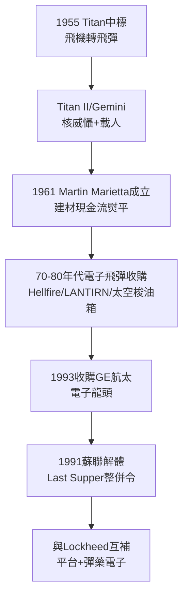

# 3.3 馬丁·瑪麗埃塔：泰坦火箭與飛彈帝國 (1957-1994)

> 本節時間：1957–1994。另一半主角的奮鬥史：Glenn Martin 公司如何從轟炸機轉向 Titan 洲際導彈、太空發射與電子系統，成為與洛克希德體量相當、互補性極強的「影子巨人」。

## 一、從飛機到飛彈：Titan 的豪賭

1955 年，美國空軍洲際導彈競賽中，馬丁擊敗對手拿下 **Titan I**（1959 首飛）與後續 **Titan II**（1962，液體燃料、可常溫貯存、作為 Gemini 載人飛船發射器）。古巴危機期間 Titan II 與 Atlas 共同構成美國陸基核威懾骨幹。

關鍵轉折：當洛克希德專注飛機時，馬丁押注**大型火箭＋系統整合**：

- Titan III（1964，捆綁固體助推器，空軍重型發射主力）；
- Titan IV（1989，冷戰末期最大一次性運載火箭，發射 KH-11、Cassini）；
- Viking、Vanguard 探空火箭技術奠定太空電子基礎。

公式：$馬丁利潤 = 戰略飛彈年金 + NASA/空軍發射服務$，現金流穩定、周期與戰機錯峰——這正是洛克希德最缺的。

## 二、Martin Marietta 的成形：建材＋軍工的怪組合

1961 年，Glenn L. Martin Company 與建材商 American-Marietta 合併為 **Martin Marietta**，總部遷至馬里蘭 Bethesda。乍看怪異，實則精妙：建材現金流熨平軍工波動，軍工高毛利反哺收購。

1970–1980 年代，Martin Marietta 大舉收購電子與飛彈資產：

- **MGM-140 ATACMS、Hellfire、Javelin 前身、MIM-104 Patriot 部分電子件**；
- LANTIRN、TADS/PNVS 夜視系統；
- 1980 年收購 Aerospace Division 後成為太空梭外掛燃料箱（External Tank）主承包商（路易斯安那 Michoud 廠）。

到 1994 年，Martin Marietta 年營收約 100 億美元，與 Lockheed（約 100 億）旗鼓相當，且業務幾乎不重疊：一個長於**平台（飛機）**，一個長於**彈藥、電子、太空發射**。

## 三、冷戰結束：整併的前夜

1991 年蘇聯解體，美國國防預算 1985–1994 年縮水逾 30%。時任國防副部長 William Perry 1993 年召集軍工 CEO「最後的晚餐」（Last Supper），明示：**養不起十幾家主承包商，鼓勵兼併**。

Martin Marietta CEO Norman Augustine 嗅覺敏銳，先下手收購 GE 航太（1993，40 億美元，拿下 GPS、雷達、系統整合），一躍成為電子系統龍頭。Lockheed CEO Daniel Tellep 則收購通用動力戰機部門（1993，拿下 F-16）。兩家都吃飽小魚後，互看對方順眼：合則成為橫跨飛機—飛彈—太空—電子的全譜系霸主。

## 因果鏈

**前因驅動：** 1957 年史普尼克衝擊（前因）創造了美國導彈—太空預算洪水，馬丁恰因轟炸機衰落而空出產能轉向火箭；建材合併的現金流（財務前因）使其能熬過 1970 年代軍費低谷並逆勢收購。這與洛克希德 L-1011 失血恰成對照——一收一放，決定了 1990 年代誰更主動。

**後果引發：** Martin Marietta 的 Titan＋太空梭油箱＋GE 電子（後果）補齊了洛克希德最弱的三塊拼圖（太空發射、戰略飛彈、系統整合），使 1995 年合併後的 Lockheed Martin 得以宣稱「從海底 Trident 到外太空 Orion 全覆蓋」（見 4.1、4.3）；其收購 GE 航太的整合經驗（後果），更直接為 1995 年更大規模的合併提供了管理劇本。
