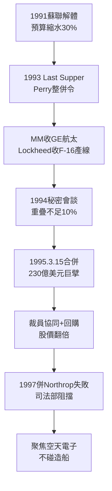

# 4.1 世紀合併：Lockheed Martin 誕生 (1993-1996)

> 本節時間：1993–1996。冷戰紅利消失之夜，兩家百億美元公司如何在 15 個月內談定 100 億美元對等合併，造出當時全球最大軍工企業，並定下「股東價值＋五角大廈效率」的雙重契約。

## 一、Last Supper 之後的搶椅子遊戲

1993 年 7 月，國防副部長 Perry 的「最後的晚餐」後，整併潮爆發：

- 1992–1994：Loral 收購 IBM 聯邦系統、Northrop 收購 Grumman；
- 1993：Martin Marietta 收購 GE 航太（ $3.05B＋債務，實約$ 4B）；
- 1993：Lockheed 收購通用動力沃斯堡戰機部（$1.525B，拿下 F-16 產線與 F-22 分工）。

兩家 CEO——Lockheed 的 Daniel Tellep 與 Martin Marietta 的 Norman Augustine——在 1994 年秘密會談，發現互補近乎完美：Lockheed 長於戰機、偵察機（U-2、F-22）、C-130；Martin Marietta 長於 Titan、Trident 飛彈電子、太空系統、砂岩級併購後的雷達與整合。重疊不到 10%。

1994 年 8 月宣布合併，1995 年 3 月 15 日正式完成，交易額約 100 億美元（換股），新公司名 **Lockheed Martin**，總部 Bethesda，首年營收約 230 億美元、員工 17 萬人。Augustine 任董事長兼 CEO，Tellep 任副董事長，權力平分。

## 二、合併的算術： $1+1>2$ 如何成立

華爾街邏輯：

$$協同效應 = 重疊裁員節省 + 議價能力提升 + 現金流熨平$$

- 關閉冗餘實驗室、整合採購，年省逾 1.5 億美元（後上調至數億）；
- 從「飛機商」變「系統整合商」，可競標 C-130J、F-22 全壽命、太空發射一攬子合約；
- 以自由現金流回購股票，股價 1995–1998 年翻倍，成為整併典範。

五角大廈邏輯：供應商越少，議價越難，但 Perry 樂見——因為國防預算大減，與其讓多家半死不活，不如保一家健康。國會附加條件：不得壟斷發射（後有 ULA 分拆伏筆），須保障就業過渡期。

## 三、蜜月與暗礁：Northrop Grumman 併購失敗

1997 年，Lockheed Martin 試圖以 115 億美元收購 Northrop Grumman，一統江湖。司法部以壟斷電子戰、雷達為由起訴阻擋，1998 年交易告吹，Lockheed Martin 支付 3.5 億美元分手費並元氣小傷。

諷刺的是，失敗反而是幸運：Northrop 的船艦資產後來證明是包袱，而 Lockheed Martin 聚焦航空—太空—飛彈—電子（後簡稱「四支柱」），避開了造船巨坑。這次挫敗確立了此後 20 年的邊界：**不碰艦船，做空天與系統的大腦**。

## 因果鏈

**前因驅動：** 蘇聯解體導致的訂單斷崖（結構前因）＋Perry 明示的整併許可（政策前因），缺一不可；兩家 1993 年各自的小併購（近因）則讓雙方都嚐到協同甜頭、建立整合團隊，直接降低了 1995 年大合併的管理風險。若無 GE 航太案練兵，百億合併極可能消化不良。

**後果引發：** 合併造出的全譜系能力（後果）是 2001 年 X-35 擊敗 X-32 的組織基礎——能同時承諾戰機＋航電＋後勤＋升級路線圖（見 4.2）；併購 Northrop 失敗（後果）則劃定了能力邊界，使公司把收購火力轉向電子與直升機（Loral、防務電子、Sikorsky，見 4.3）。一成一敗，共同定義了巨擘的形狀。
