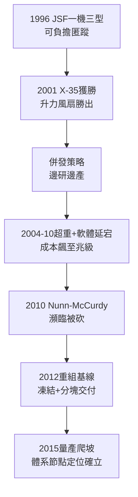

# 4.2 聯合打擊：F-35 得標與量產之路 (1996-2015)

> 本節時間：1996–2015。從 X-35 驗證機到三軍通用、九國合資的 F-35 Lightning II：人類史上最大軍購計畫如何得標、如何超支延期，又如何爬出「死亡螺旋」走向量產。

## 一、X-35 對 X-32：醜小鴨與天鵝

1996 年，聯合打擊戰機（JSF）競標：取代 F-16、A-10、AV-8B、F/A-18C/D 等多機種，要求**一機三型**（A 常規、B 短距垂直起降、C 艦載）＋匿蹤＋超音速＋可負擔（目標單價約 5,000 萬美元）。

- **Lockheed X-35**：軸驅動升力風扇（Rolls-Royce 團隊、源自 Yak-141 啟發的升力風扇＋主發動機聯動），超音速時蓋板閉合，阻力小；
- **Boeing X-32**：直接升力式（主發動機偏轉），進氣道巨大如「笑臉」，超音速性能與匿蹤較遜。

2000–2001 年驗證試飛，X-35 完成短距起飛—超音速—垂直降落連續科目，X-32 則為減重拆掉部分零件引發疑慮。2001 年 10 月 26 日，五角大廈宣布 **Lockheed Martin 獲勝**，合約潛值逾 2,000 億美元（後全壽命破兆）。命名 F-35 Lightning II，向 P-38 致敬。

## 二、死亡螺旋：併發研發的代價

得標即噩夢開始。為趕時程，五角大廈採用**併發（concurrency）**：邊研發、邊測試、邊量產。結果：

- 2004–2010 年重量超標（B 型尤甚，減重 1,200 公斤的「SWAT」行動）、軟體（Block 2B/3F）延宕；
- 成本從 1996 年估 2,000 億全壽命飆至 2011 年估近 1.5 兆美元（含 50 年維保），單價破億；
- 2010 年 Nunn-McCurdy 違約（成本超標觸發國會審查），計畫差點被砍；國防部長 Gates 開除計畫主管、扣留承包商獎金。

轉機在 2012 年後：重組基線（新的成本＋時程）、凍結設計、軟體分塊交付、國際夥伴加碼（英國、義大利、日本、以色列等）。到 2015 年，F-35A 宣布 IOC（初始作戰能力）前夜，年產突破 40 架，學習曲線終於下彎：$單價 \propto 累計產量^{-0.15}$。

## 三、為何非它不可？三位一體之外的第四支柱

F-35 的真正賭注不是性能而是**體系**：AN/APG-81 雷達＋DAS 分布式孔徑＋MADL 隱身數據鏈，使其成為「飛行感測器＋指揮節點」。一架 F-35 發現的目標可導引神盾艦的 SM-6——這是 F-16 永遠做不到的。

對 Lockheed Martin 而言，F-35 意味著未來 30 年的年金：生產（沃斯堡＋義大利 Cameri＋日本名古屋）＋維保（ALIS/ODIN 系統）＋升級（Block 4）。2015 年時雖仍爭議纏身，但 3,000 架級訂單已鎖定其巨擘地位。

## 因果鏈

**前因驅動：** F-22 減產至 187 架導致的「匿蹤缺口」（前因）＋AV-8B/海鷂老化（前因），使三軍被迫接受「一機三型」的妥協；X-35 升力風扇的技術勝出（近因）則源於 1990 年代與 Yakovlev 的技術交流＋勞斯萊斯升力系統積累。若無 F-22 太貴的前車，國會絕不會容忍單一計畫通吃。

**後果引發：** 併發災難的教訓（後果）重塑了五角大廈採購文化（後來的 B-21 堅決反併發）；F-35 的軟體—感測器體系（後果）則把 Lockheed Martin 從「飛機商」推向「作戰雲商」，為 2015 年後 JADC2、太空—空中組網（見 5.2）鋪路；而國際合資結構（後果）更使 F-35 成為美國同盟體系的硬體黏合劑，其地緣後果遠超一型戰機。
