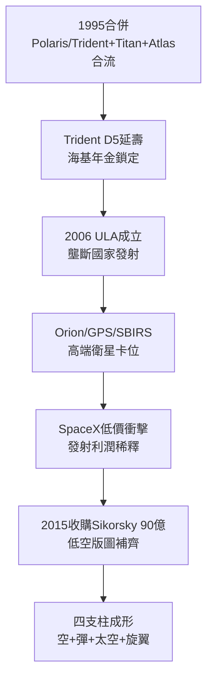

# 4.3 版圖擴張：Trident、太空與 Sikorsky (1995-2015)

> 本節時間：1995–2015。戰機之外，巨擘的另外三條腿：海基核威懾（Trident）、太空發射與衛星（Atlas、Orion、GPS），以及 2015 年 90 億美元收購 Sikorsky 黑鷹——從「戰機公司」到「全譜系系統商」。

## 一、Trident：深海的年金

Lockheed Martin 自 1950 年代 Polaris 起即為美國海基戰略飛彈主承包商，合併後繼承 **Trident II D5**（三叉戟，1989 服役，射程 $12,000\,km$、最多 14 枚分導核彈頭，現限 8 枚）全壽命合約：生產、延壽（D5LE 至 2040 年代）、英美共用（英國 Vanguard/ Dreadnought 亦用 D5）。

Trident 的意義不在技術炫目而在**不可替代＋年金**：美英海基威懾別無二家，每年數十億美元穩定流入，不受戰機周期影響。2015 年，公司飛彈與火控（MFC）部門約 1/4 營收與戰略—戰術飛彈（THAAD、PAC-3、ATACMS、Javelin 聯合）相關。

## 二、太空：Atlas、Orion 與 GPS

合併後的太空版圖：

- **Atlas**：Martin Marietta 的 Atlas/Centaur＋洛克希德發射服務，1995–2006 年主導美國商用發射；2006 年與波音合資成立 **ULA（聯合發射同盟）**，以 Atlas V＋Delta IV 壟斷國家安全發射至 SpaceX 崛起前；
- **Orion（獵戶座）**：2006 年拿下 NASA 下一代載人飛船，2014 年 EFT-1 無人繞地成功，定位為 Artemis 登月計畫指令艙；
- **GPS III、SBIRS 紅外預警、MUOS 窄帶通訊**：鎖定軍用衛星高端（精密＋抗干擾），避開商用低軌價格戰；
- 哈伯太空望遠鏡維修、火星 Viking／後續探測器 heritage 亦多源自 Martin Marietta。

太空公式：$利潤 = 高可靠溢價 \times 政府年金 - 商用發射虧損$，故 2006 年以 ULA 分攤風險是理性收縮。

## 三、Sikorsky：2015 年的 90 億豪賭

2015 年 7 月，Lockheed Martin 以 **90 億美元**從 UTC 收購 **Sikorsky**（西科斯基，UH-60 黑鷹、CH-53K、S-92、海鷹）。邏輯：

1. 直升機與 F-35、C-130 共享陸軍／海軍陸戰隊客戶，交叉銷售；
2. 拿下 **VH-92 總統直升機（陸戰隊一號）**與 CH-53K 重型直升機年金；
3. 補齊「空—地—海—太空」最後一塊低空版圖，對沖戰機波動。

收購後成立 Rotary and Mission Systems（RMS）為最大部門之一，員工人數破萬。華爾街一度質疑太貴，但 2020 年代直升機升級（FLRAA 競標中的 Defiant X 雖落敗，仍有龐大黑鷹升級市場）證明其防禦價值。

## 因果鏈

**前因驅動：** 冷戰核三位一體的路徑依賴（前因）使 Trident 合約天然延續；F-35 併發危機暴露的「單腿風險」（前因）則驅使管理層用太空＋旋翼對沖。若無 2006 年 ULA 分攤發射風險，公司可能在商用發射價格戰中失血更多。

**後果引發：** Trident＋Orion＋GPS 的政府年金（後果）為 F-35 超支年代提供了現金流緩衝，使公司敢於墊資保量產；Sikorsky 的客戶網絡（後果）則為 2020 年代 JADC2（跨軍種組網）提供了陸軍入口；而 ULA 壟斷的終結（後果，SpaceX 競爭）又倒逼 2015 年後加碼高超音速與飛彈防禦（見 5.2）——擴張即為了下一次收縮時的餘裕。
