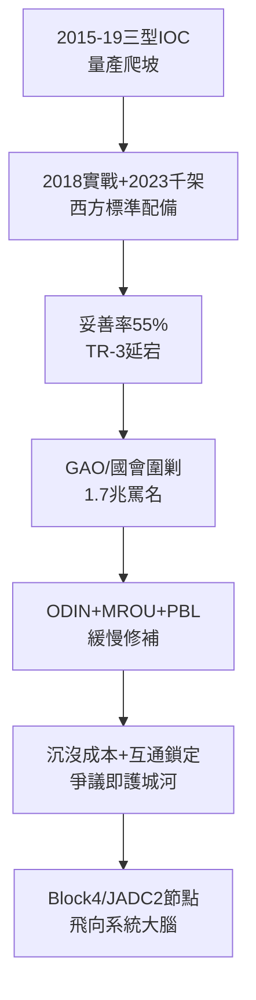

# 5.1 F-35 的考驗：成本、妥善率與全球機隊 (2015-2026)

> 本節時間：2015–2026。從 IOC 到千架交付：F-35 如何在「最貴計畫」的罵名中成為西方空權標準配備，又為何妥善率（mission capable rate）始終是阿基里斯腱。

## 一、從 IOC 到千架：量產終於開花

- 2015 年 7 月 F-35B（陸戰隊）、2016 年 F-35A（空軍）、2019 年 F-35C（海軍）相繼宣布 IOC；
- 2018 年以色列 F-35I 首次實戰（打擊敘利亞境內伊朗目標），證明匿蹤＋情報融合在實戰防空網中的價值；
- 2023 年交付突破 1,000 架，裝備美軍＋英、日、韓、澳、以、義、挪、荷、丹、比、波、芬、瑞士等 20 國（訂購／交付中），年產穩定 130–150 架；
- F-35A 單價從 2011 年逾 1.2 億美元降至 2022 年約 8,000 萬美元（TR-3 升級前），學習曲線兌現。

俄烏戰爭（2022–）更凸顯其價值：北約 F-35 在東翼長期前沿部署，DAS＋MADL 為防空網提供早期預警，雖未直接參戰，卻成為威懾象徵。芬蘭、德國、瑞士相繼選購，訂單不減反增。

## 二、罵名不滅：妥善率與 sustainment 黑洞

然而批評從未停歇：

1. **妥善率低迷**：2022–2024 年美國 GAO 報告，F-35 全任務妥善率約 50–55%，遠低於 75–80% 目標；發動機（F135）葉片、隱身塗料維修、ALIS/ODIN 後勤系統誤報是三大元兇；
2. **TR-3/Block 4 延宕**：2023–2024 年 Technology Refresh 3 硬體＋Block 4 軟體延期，數十架新機滯留沃斯堡無法交付，五角大廈一度拒收；
3. **全壽命 1.7 兆美元估值**：雖含 60 年通膨，但仍是國會聽證會的固定靶子；空軍部長 Kendall 直言「買得起、用不起」。

Lockheed Martin 的回應：擴大全球維修網（MROU，澳洲、日本、歐洲）、推 ODIN 替代 ALIS、承諾「按飛行小時收費」的績效合約（PBL）。成效有，但慢於預期—— $妥善率 = 零件供應 \times 診斷準確 \times 人力訓練$ ，三者皆需時間。

## 三、互相驅動：爭議即護城河？

弔詭的是，爭議本身鞏固了地位：沉沒成本逾千億＋20 國後勤互通，使任何替代方案（NGAD、GCAP）在 2030 年前都無法撼動 F-35。批評越烈，改進預算越多；改進越多，鎖定越深。這正是兆級計畫的政治經濟學。

## 因果鏈

**前因驅動：** 2000 年代併發決策（前因，見 4.2）把技術債留給 2015 年後的維保體系；一機三型的高共用率承諾（前因）則使任一型的故障牽連全機隊。若當年採串行研發，妥善率問題會小得多，但量產時程將晚 5 年、錯過反恐—大國競爭轉換窗。

**後果引發：** F-35 的妥善率危機（後果）直接催生 2020 年代「數位孿生＋預測維修」投資潮，並為 NGAD（下一代空優）確立「反併發、分系統成熟再整合」原則；其全球機隊的互通紅利（後果）則使美國在援烏、印太威懾中獲得額外的同盟槓桿——戰機的因果，早已溢出戰機本身。
