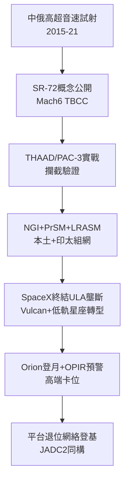

# 5.2 重返高超音速：SR-72、飛彈防禦與太空新局 (2015-2026)

> 本節時間：2015–2026。當中俄高超音速武器試射成功，Lockheed Martin 如何從 F-35 製造商回防「Kelly Johnson 式突襲」：SR-72 傳說、THAAD／PAC-3 實戰、下一代攔截器（NGI）與低軌衛星群。

## 一、SR-72：黑鳥的幽靈歸來

2013 年，臭鼬工廠罕見公開 **SR-72** 概念：$Mach\,6$ 高超音速無人（可選有人）偵察—打擊機，TBCC（渦輪＋衝壓組合）動力，2030 年代服役。此後十年消息若隱若現：

- 2017–2023 年多次傳出縮比驗證機在 Groom Lake 試飛；
- 2022 年《捍衛戰士：獨行俠》開場「Darkstar」即以 SR-72 為原型，軍方默許曝光被解讀為戰略訊息；
- 真實進度仍屬黑預算，但 J58→变循環→TBCC 的技術譜系清晰可辨。

無論 SR-72 是否量產，其訊號明確：**速度崇拜回歸**，與 F-35 的匿蹤—融合路線互補。黑鳥當年「太快而無用」的遺憾，在高超音速導彈時代被重新定價。

## 二、飛彈防禦：從保證到實戰

2015 年後，Lockheed Martin 的飛彈與火控（MFC）成為增長引擎：

- **THAAD（薩德）**：2017 年部署韓國星州，2023–2024 年中東攔截實戰（紅海／以色列方向）驗證末段高空攔截；
- **PAC-3 MSE**：俄烏戰爭中愛國者系統多次攔截 Kinzhal 高超音速導彈（2023 基輔上空），MSE 增程型需求暴增，產線擴至年產 500＋枚；
- **LRASM、JASSM-ER、PrSM**：遠程反艦／對地精確打擊家族，對應印太「反介入」想定；
- **NGI（下一代攔截器）**：2021 年拿下 MDA 合約，研發本土彈道防禦新彈頭，應對中俄分導＋誘餌。

公式：$MFC增長 = 地緣衝突 \times 攔截彈消耗 \times 補庫訂單$，2022–2024 年三者同向爆發。

## 三、太空新局：從 ULA 壟斷到分散星座

SpaceX 以 Falcon 9 終結 ULA 壟斷後，Lockheed 轉向：

- **ULA Vulcan**（2024 首飛，BE-4 發動機）接替 Atlas/Delta，保住國家安全發射份額；
- **Transport Layer／SDA 低軌衛星**：為太空發展局批量造小型通訊—跟蹤衛星，從「精品大衛星」轉向「可耗損星座」；
- **Orion＋Artemis**：2022 年 Artemis I 無人繞月成功，Orion 仍是美國重返月球的唯一載人艙；
- **GPS IIIF、SBIRS 後繼 Next-Gen OPIR**：維持戰略預警高端。

換言之，太空戰略從「壟斷發射」轉為「組網＋載荷」，與 F-35 的 JADC2 節點邏輯同構：**平台退位，網絡登基**。

## 因果鏈

**前因驅動：** 黑鳥的 TBCC 技術儲備（遠因）＋中俄高超音速突襲（近因），共同復活了高速路線；俄烏戰爭的彈藥消耗（前因）則把 THAAD/PAC-3 從庫存變成現金牛。若無 2014 年克里米亞危機後歐洲重整軍備，MFC 不會有今日產能。

**後果引發：** 飛彈防禦的實戰數據（後果）回流為 NGI 與 Block 4 攔截算法；而低軌星座的批量模式（後果）正倒逼臭鼬工廠改變「精品黑機」習慣，學習 SpaceX 式快速迭代——高速與低成本的矛盾（後果），將是下一代 SR-72／NGAD 成敗的關鍵因果結。
