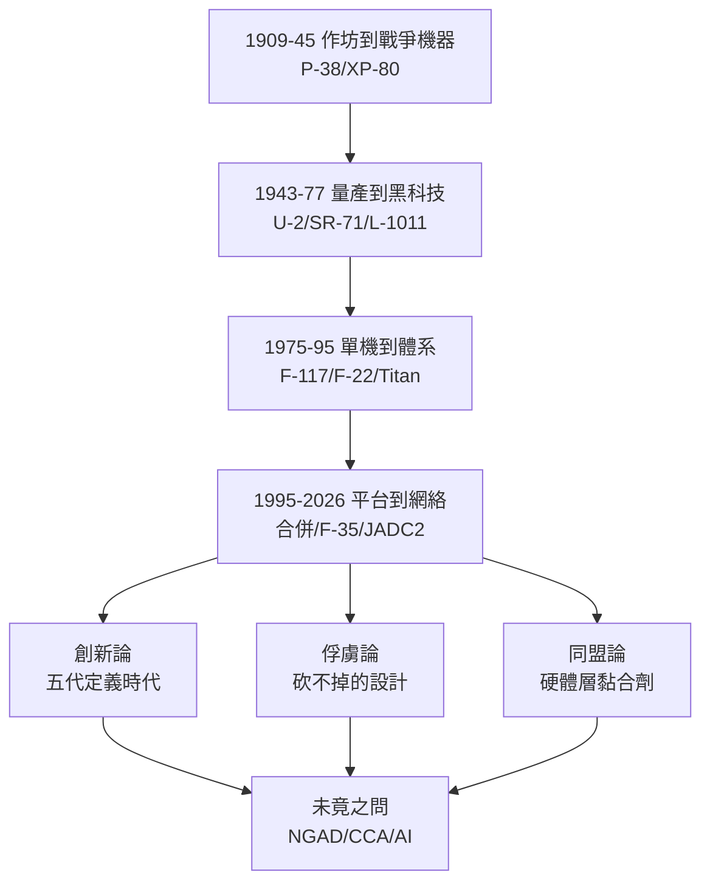

# 5.3 歷史評價：軍工複合體的縮影 (1909-2026)

> 本節時間：1909–2026。全書總結：Lockheed Martin 如何從兩間木造小廠變成 17 萬人、年營收逾 700 億美元的軍工複合體縮影？它的成功是創新的勝利，還是制度俘虜的警示？

## 一、百年因果總覽：四次轉型

1. **1909–1945：從作坊到戰爭機器**——馬丁的製造紀律＋洛克希德的設計冒險，在二戰量產中合流（P-38、B-17 分包、XP-80）；
2. **1943–1977：從量產到黑科技**——臭鼬工廠以 U-2、SR-71 證明小團隊可抵償大組織，卻以 L-1011 證明大組織不可玩民航；
3. **1975–1995：從單機到體系**——F-117（匿蹤）、F-22（超巡＋融合）、Titan/Trident（核威懾＋太空），三線各自登頂，互補性成熟；
4. **1995–2026：從平台到網絡**——合併＋F-35＋Sikorsky＋JADC2，飛機變成感測器，感測器變成同盟黏合劑。

貫穿始終的組織基因是 **Kelly's 14 Rules 與 Bethesda 財務紀律的張力**：前者要求冒險、保密、小步快跑；後者要求可預測利潤、回購、分紅。F-117 成功時前者主導，F-35 困境時後者反噬。

## 二、功與過：三組評價

**創新論**：U-2、SR-71、F-117、F-22、F-35 五代跨越，每代皆定義時代；鈦加工、匿蹤、融合、TBCC 外溢全行業。沒有 Lockheed Martin，美國空權至少晚十年。

**俘虜論**：兆級計畫＋旋轉門（高管—五角大廈互聘）＋國會就業綁定（F-35 零件遍布 48 州），使「砍不掉」成為設計的一部分。$國防效率 = 技術紅利 - 尋租溢價$，後者在 2000 年後顯著上升。

**同盟論**：F-35 的 20 國機隊、Trident 的英美共用、THAAD 的韓國／中東部署，使公司成為美國同盟體系的硬體層。批評者視為軍售綁架，支持者視為和平紅利——同一事實，兩種因果敘事。

## 三、未竟之問：下一個百年

- NGAD（第六代）是否重蹈 F-22 覆轍？無人僚機（CCA）會否顛覆有人戰機？
- SpaceX 式低成本會否終結黑預算溢價？
- AI 飛行員＋自主蜂群時代，臭鼬工廠的小團隊模式是否依然有效？

Lockheed Martin 的傳記至此不是終點，而是美國軍工體制百年實驗的中期報告：**創新與俘虜本是同枚硬幣的兩面，差別只在外部威脅是否真實**。有蘇聯、中俄為鏡，浪費被容忍為保險費；無敵人時，同樣的結構即被斥為腐敗。這或許是本書最冷的因果鏈。

## 因果鏈

**前因驅動：** 雙源頭的互補基因（遠因，見 1.1）＋冷戰—後冷戰—大國競爭的三波威脅（結構前因），共同把兩間小廠推成巨擘；每一次瀕死（1932 破產、1971 紓困、2010 Nunn-McCurdy）都以更大規模復活——危機即整併的燃料。

**後果引發：** Lockheed Martin 的百年證明了一個通用因果：**當技術突襲能轉化為戰略時間（U-2 爭取 4 年、F-117 爭取一場戰爭、F-35 爭取同盟 30 年），高溢價即被追認為合理**；反之（L-1011、F-22 減產），再先進亦被視為浪費。本書所有章節的因果鏈，最終都匯入這一條判準——而下一個判準，將由高超音速、AI 與太空星座寫就。
