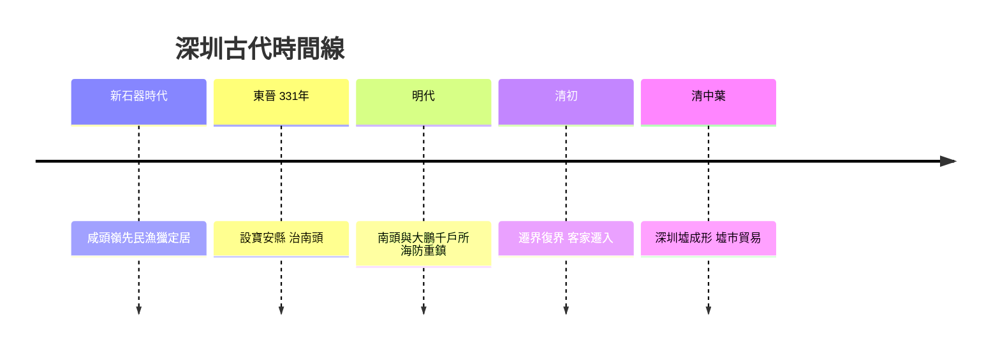

# 1.1 鹹淡水之交：地理與先民

深圳位於珠江口東岸，東臨大鵬灣、西瀕伶仃洋，與香港僅一河之隔。這裡是鹹淡水交匯之地：西部的福田、南山一帶曾有連片的紅樹林與灘塗，適合蠔田與鹽田；東部的大鵬半島則多山多灣，漁村散落。這種「半漁半農」的地理稟賦，決定了此地在數千年間始終是人口稀疏的邊陲。

考古發掘顯示，新石器時代中晚期已有先民在此漁獵定居，咸頭嶺遺址出土的彩陶距今約六七千年。秦代置南海郡，此地屬番禺縣轄境；東晉咸和六年（331年）設寶安縣，縣治即在今天的南頭古城。此後一千六百餘年，「寶安」之名幾經存廢，管轄範圍時大時小，但始終是帝國東南沿海的末端神經。

明代為防倭寇與海盜，在此設東莞守禦千戶所與大鵬守禦千戶所，南頭古城一度是「嶺南重鎮」。清代遷界復界之後，客家人大批遷入，與廣府、鶴佬人群雜處，形成多元的方言與宗族格局。位於今日市中心的深圳墟，因水陸埠頭之利成為周邊墟市的集散點，「深圳」二字——意為深切的溝渠——開始出現在文獻中。

## 因果分析

地理是深圳最早的一組因果鏈起點。鹹淡水交匯帶來灘塗與鹹田，農業產出有限，反而促成了鹽業、蠔業、漁業與墟市貿易的經濟結構；而這種不穩定的生計，加上地處省城與海洋之間的末梢位置，使本地人口長期流動不定。明清的海防設置是另一條因果線：朝廷的海洋恐懼帶來所所城與遷界，壓抑了本地發展，卻也讓此地保留了大量未開發土地與稀疏人口——這在數百年後，恰恰成為特區可以「白紙作畫」的物質前提。帝國邊陲的失敗，意外的成為改革前線的成功條件。

