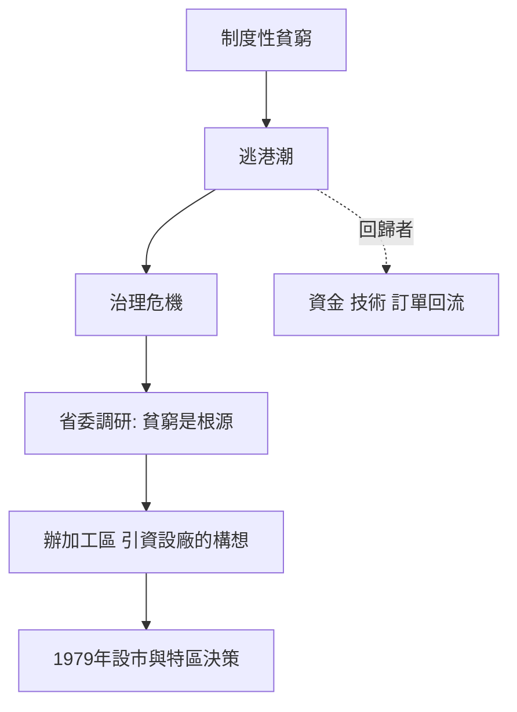

# 1.3 大逃港與邊界的那盞燈

從1950年代到1970年代末，寶安發生了多次大規模逃港潮，其中以1962年與1979年兩次最為驚人。逃港者泅渡深圳灣、翻越梧桐山、藏身貨車，歷盡風險投奔香港。據估算，數十年間先後有上百萬人次嘗試，成功者數以十萬計。對當時的北京而言，這是最刺眼的政治傷口：人民用腳投票，選擇了對岸。

1977年冬，時任廣東省委書記習仲勳到寶安調研，目睹邊民外逃的慘狀與兩岸懸殊的生活水平，得出結論：逃跑不是敵我矛盾，而是人民對貧窮的反抗，「只有把生產搞上去，才能堵住外逃」。這一判斷觸發了廣東上下的政策反思——既然堵不住，能否用「發展」來替代「堵截」？

於是出現了一個在當時石破天驚的思路：利用寶安毗鄰香港的條件，辦出口加工區，引進港資辦廠，讓邊民就業增收，以經濟辦法解決政治問題。1978年，惠陽地委與廣東省委先後提出在寶安、珠海設置對外加工基地的設想；同年蛇口的招商局也在醞釀「上書」。逃港潮由一場治理危機，轉化為改革請命的政治動能。

## 因果分析

大逃港是特區誕生最直接的因果觸發點。因果鏈條十分清晰：制度性貧窮導致外逃，外逃構成治理危機，治理危機迫使地方官員正視「貧窮才是根源」，從而催生以開放求發展的政策方案。這說明深圳特區的原始動機首先是政治維穩與民生自救，其次才是經濟雄心。而逃港者本身也以人力資本的形式反哺了深圳——日後特區人口中大量是歸來的逃港者及其親屬，他們帶回了資金、技術、訂單與對市場的直覺。邊界那盞燈照亮的，最終是燈這一邊的土地。

