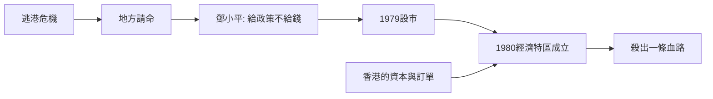

# 2.1 1979：設市與鄧小平的決策

1979年1月，國務院批准撤銷寶安縣，設立深圳市，走出了從「防守邊境」到「開放前沿」的第一步。同年7月，中央決定在廣東、福建試辦「出口特區」，深圳、珠海、汕頭、廈門四地入選；1980年8月，全國人大批准《廣東省經濟特區條例》，正式定名「經濟特區」。深圳特區以327.5平方公里起步，是四個特區中面積最大、也最靠近香港的一個。

決策的關鍵一幕流傳甚廣：1979年4月中央工作會議上，時任廣東省委第一書記習仲勳向鄧小平匯報，希望中央給權、給政策，在廣東劃出一塊地方辦出口加工區。鄧小平說出那句名言：「還是叫特區好，陝甘寧邊區就是特區嘛。」並留下「中央沒有錢，可以給些政策，你們自己去搞，殺出一條血路來」。這是一場精心的政治授權：中央不出資本，只給制度空間。

深圳獲得的「政策資本」包括：關稅減免、外資企業所得稅優惠、土地使用費制度、勞動用工自主權，以及相對獨立的審批權限。在計劃經濟的汪洋中，這相當於圈出一塊制度試驗田——失敗可限於一隅，成功則可向全國複製。

## 因果分析

設市與建特區的因果結構，是「壓力—授權—試驗」的三段式。逃港危機與財政困難構成壓力；鄧小平以「給政策不給錢」的方式完成授權，既降低了中央的政治與財政風險，又將成敗責任下放給地方，激發地方官員的企業家精神。特區制度之所以選擇深圳為龍頭，則是地理因果：一線之隔就是香港這個成熟的國際金融、貿易與製造中心，可以最低成本承接資本、訂單與管理知識的溢出。特區名稱中的「經濟」二字，也是精心計算的——限定改革範圍，減少意識形態阻力。制度試驗場的定位，從第一天起就寫進了這座城市的基因。

$$
\text{特區產出} = f(\text{政策資本},\ \text{香港溢出},\ \text{勞動力流入},\ \text{時間})
$$

