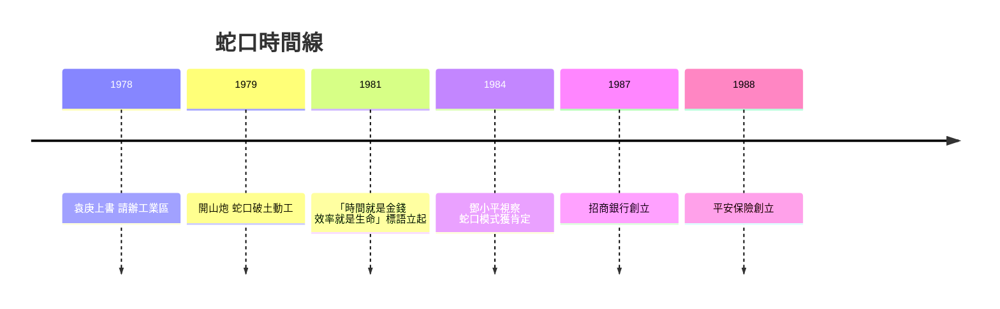

# 2.2 蛇口開炮：袁庚與「時間就是金錢」

1979年1月，香港招商局常務副董事長袁庚起草的《關於充分利用香港招商局問題的請示》獲中央批准，招商局獲准在寶安蛇口開發工業區，「獨立自主經營，自籌資金，自擔風險」。同年7月，蛇口工業區破土動工，比特區條例公布還早一年多，被稱為「改革開放的第一聲開山炮」。

袁庚是從事過情報工作的老革命，深諳國際商業規則。他在蛇口推行了一整套今天看來平平無奇、當時卻驚世駭俗的制度：工程招標取代政治動員式的施工；幹部人事制度改為民主評議與聘任制；職工住房商品化；實行超產獎勵，多勞多得。1978年寫進報告、1981年立上標語的「時間就是金錢，效率就是生命」，成為整個時代最响亮的一句口號。蛇口還創辦了蛇口工業區培訓中心，後來演變為招商銀行、平安保險、中集等一批企業的搖籃——蛇口不僅造廠，還造企業家。

袁庚那句「我們要讓這裡的每一寸土地，都長出金子」的背後，是一個更深的設計：蛇口是「制度孵化器」，它的產品不是工業品，而是可複製的制度與人才。

## 因果分析

蛇口的因果貢獻在於它先於特區總框架完成了「試驗的試驗」。因為招商局是部屬企業、自負盈虧，蛇口繞開了計劃體制的條條塊塊，得以用市場規則直接對接香港資本。招標制解決了效率問題，獎金制解決了激勵問題，聘任制解決了幹部約束問題——三者共同把「時間」變成可定價的資源，這正是「時間就是金錢」的微觀經濟學含義。蛇口的成功為特區提供了可見的證據與可推廣的範本，加速了外商對特區的信心；其培養的幹部與企業家，又在隨後數十年持續外溢，成為深圳乃至全國市場化改革的種子庫。

