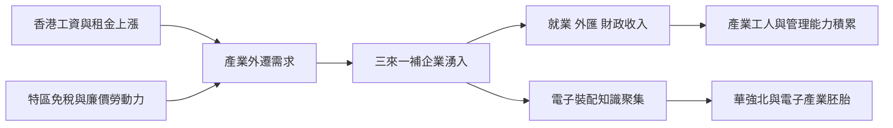

# 3.1 三來一補：港資北上的排隊效應

1980年代中期至1990年代，深圳製造業的主力模式是「三來一補」：來料加工、來樣加工、來件裝配與補償貿易。香港廠商提供設備、原料、樣品與訂單，深圳提供廠房、土地與勞動力，產品出口，深圳賺取加工費。到1990年代初，深圳三資與三來一補企業中，港資占比高達八成以上。

驅動這一格局的是兩岸要素價格的巨大落差。1980年代香港製造業工資快速上漲、廠房租金昂貴，而深圳一位工人月工資僅為香港的十分之一左右，土地幾乎免費。深圳特區在1979至1985年之間的工業總產值年均增速超過50%，靠的正是這種「香港接單、深圳生產」的跨境分工。來料加工裝配企業數量從1980年代的數百家增至1990年代中期的上萬家，形成排隊進場的規模效應。

三來一補的技術含量不高——電子錶、玩具、假髮、成衣、簡單電子元件——但它完成了一項至關重要的歷史任務：把數十萬從田裡走出來的農民訓練成產業工人，把深圳的廠長訓練成懂得品管、交期、成本核算的現代管理者。

## 因果分析

三來一補是地理紅利與制度紅利疊加的必然產物。因果鏈為：香港成本上漲驅動產業外遷，特區的免稅政策與勞動力優勢構成引力，兩者相撞產生加工貿易浪潮；加工貿易又帶來外匯、就業與政府收入，支撐了特區初期的財政與城建。更關鍵的是隱性的因果傳導——加工環節雖然低端，卻強制建立了「訂單—品質—交期—報價」的市場紀律，這種紀律內化為深圳勞動力與管理層的能力存量，成為後來產業升級的前提。同時，港資工廠帶來的電子裝配知識，在空間上集中於羅湖、上步一帶，直接孕育了華強北電子市場與深圳電子產業的胚胎。今天的深圳製造，就是從當年的「來件裝配」中爬升出來的。

