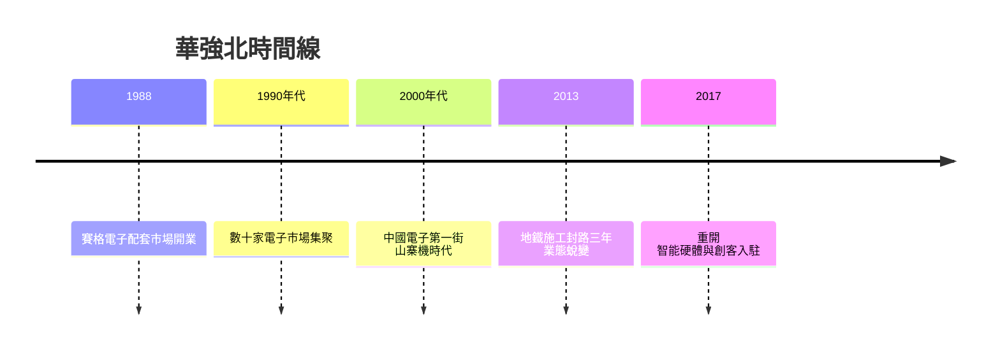

# 3.2 電子加工與華強北的誕生

1988年，深南中路旁的華強北路，賽格電子配套市場開業，一層樓裡擠進了七百多個檔口，中國第一個電子專業市場就此誕生。到1990年代，華強北與賽格廣場周邊集聚了數十家電子市場、上萬個商鋪，從元器件、整機到二手拆機件無所不有，成為「中國電子第一街」。

華強北的出現有著清晰的產業邏輯。深圳的電子加工廠需要元器件供應，原本依賴香港中轉；當市場規模足夠大時，元器件交易本身落地深圳，就近供貨，縮短了交期、降低了庫存。計劃體制下電子物資靠配給調撥，華強北則以市場定價、現貨交易，成為計劃外體系的物資總閘門。全國的電子廠、維修鋪、大學實驗室都到這裡採購，「到華強北進貨」成為一代工程師與創業者的共同記憶。

華強北同時也是一個資訊交易所：什麼元件漲價、什麼方案流行、什麼整機暢銷，市場價格每天更新。這種高頻資訊流，讓深圳對全球電子產業的脈動保持著近乎即時的感知。

## 因果分析

華強北是電子加工產業規模化之後的必然衍生，因果鏈為：加工廠集聚製造元器件需求，需求集聚催生現貨市場，現貨市場再降低採購門檻與交期成本，又反過來吸引更多組裝廠與創業者落戶——形成「產業—市場」互為因果的正反饋環。其深遠影響在於：元器件的現貨可得性把硬體創業的固定成本壓到極低，一個工程師帶著想法走進華強北，幾天內就能配齊樣機物料，這在世界任何地方都難以複製。1980年代的市場交易實踐，也在無形中訓練了計劃經濟下成長的一代人對價格信號的理解。華強北因此不僅是賣場，更是深圳創新生態的物流與資訊基礎設施。

$$
\text{採購成本} = C_0 - \alpha \cdot \ln(\text{市場集聚度})
$$

集聚度越高，單位採購成本越低，且呈對數遞減——這正是華強北規模效應的數學寫照。

