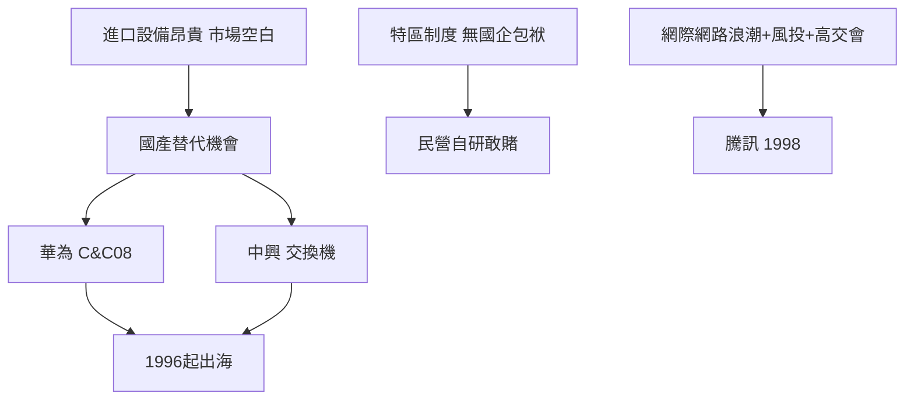

# 3.3 本土種子：華為、中興與騰訊

在世界工廠的喧囂之下，深圳本土企業的種子已經發芽。1987年，43歲的任正非以2.1萬元在深圳創立華為，最初代理香港公司的程控交換機，隨後孤注一擲投入自研，1993年推出C&C08數字程控交換機，以農村包圍城市的策略攻占縣鄉市場。1985年成立的中興通訊同樣從交換機起家，1997年先後在A股上市。兩家公司選擇電信設備而非組裝加工，是因為這一領域技術門檻高、國內市場空白，進口設備昂貴，「巨大中華」由此獲得替代進口的歷史機會。

1998年11月，馬化騰與四位夥伴創立騰訊，模仿以色列人的ICQ開發OICQ，即後來的QQ。創業初期資金枯竭、幾度想賣掉軟體，最終靠IDG與盈科的風險投資度過網際網路寒冬。1990年代深圳的政策環境也開始轉向：1993年深圳在全國率先終結「暫住證」外的勞動用工束縛，1995年前後出台扶持高新技術產業的政策，1999年創辦中國國際高新技術成果交易會（高交會），並設立風險投資體系。

華為1996年起開拓國際市場，中興1998年拿下巴基斯坦大單，深圳公司第一次以自主品牌走向世界。

## 因果分析

本土企業崛起的因果鏈是「模仿—替代—自研—出海」。因為電信設備進口昂貴且受制於人，催生國產替代的市場空間；因為深圳沒有國企包袱、土地與勞動成本低，民營企業敢於全押自研；因為特區的公司制度、股權激勵與相對寬鬆的戶籍環境，人才敢於南下聚集。騰訊的誕生則說明另一層因果：1990年代末全球網際網路浪潮與本土即時通訊需求相遇，深圳成熟的風險投資與高交會平臺提供了資本出口。三家公司共同揭示了一個模式——深圳的優勢不在於技術起點，而在於把市場需求與工程能力快速耦合的環境。世界工廠的利潤與人才池，正是這些種子企業最初的養分。

