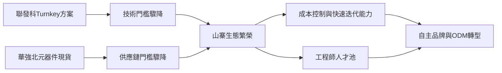

# 4.2 山寨生態系：灰色地帶的孵化器

2000年代中後期，「山寨」成為深圳最富爭議的標籤。以華強北為中心，成千上萬的小廠與檔口組成了模仿製造的生態系：從山寨手機、平板到電子玩具，抄襲知名品牌外觀與功能，以極低價格行銷全國與新興市場。聯發科2004年後推出的Turnkey交鑰匙晶片方案，把手機研發拆解成「買方案—組裝—貼牌」三步，令小廠進入門檻驟降；深圳地下渠道的元器件現貨與「一條街搞定供應鏈」的能力，則完成了其餘的配套。

山寨的社會評價兩極：它是侵權與低質的代名詞，卻也是一場規模空前的市場教育。山寨機把行動電話帶給了月收入千元以下的人群，把觸控螢幕、雙卡雙待、超大喇叭等「土味創新」反向輸出給主流品牌——後來被正式命名為「微創新」的許多功能，最早正是山寨廠的求生技巧。

更重要的是山寨生態對人才的訓練。在山寨廠打磨過的結構工程師、方案工程師、供應鏈採購與外貿業務員，數年後大量流入正規創業公司。「山寨—出師—自立」成為深圳工程師階層的階梯，公版方案與華強北的公地則降低了每一次創業的第一道門檻。

## 因果分析

山寨是一個典型的「灰色過渡制度」：在智慧財產權執法與品牌積累都薄弱的階段，模仿是後發者吸收產品知識最低成本的路徑。因果鏈為：Turnkey方案降低技術門檻，現貨市場降低供應鏈門檻，兩者共同催生山寨繁榮；山寨競爭的極端激烈又反向強化了兩種能力——極致的成本控制與快速迭代，這恰恰是日後硬體創新的核心能力。當消費升級與品牌化需求到來、執法趨嚴，純模仿的利潤消失，山寨生態並未消亡，而是分化：一部分死亡，一部分轉型為ODM白牌力量，一部分孵化出大疆、傳音式的自主品牌。山寨因此應被理解為創新的幼稚期，而非創新的反面。

